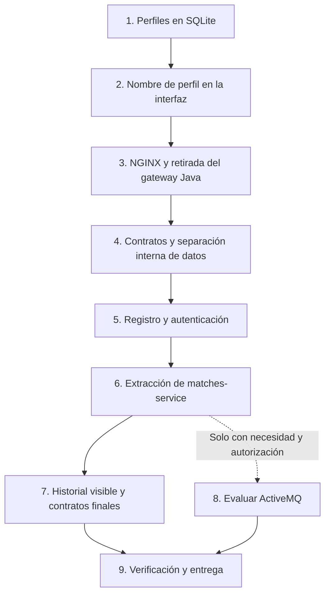

# Plan de desarrollo de Regalia

Fecha de revisión: 24 de noviembre de 2026.

Este documento se escribe en español por petición expresa del usuario. El código, la interfaz y el README mantienen el inglés. Es una propuesta de trabajo: las fases pendientes no describen funcionalidades existentes ni autorizan automáticamente nuevas tecnologías o commits.

**Alcance: todo el proyecto, desde su estado actual hasta la entrega final.** Incluye el dominio de ajedrez, el frontend, todos los servicios indicados en clase, sus bases de datos, la identidad y los permisos, la comunicación, NGINX, la verificación y la documentación. Las partes ya implementadas se conservan y se vuelven a comprobar durante las extracciones. Completar la persistencia de perfiles o incorporar NGINX no equivale a terminar el proyecto.

## 1. Punto de partida comprobado

La referencia versionada es `424e30e`, ya subida con el alta y la baja de cuentas del paso 5.2. Este cambio completa el paso 5.3: authentication-service implementa login, consulta y logout, caducidad absoluta y por inactividad y comprobación de cuenta activa. Comparte la SQLite de cuentas con registro y cada servicio escribe solamente sus tablas. La verificación pasa 172 pruebas Java, incluidas 17 nuevas de autenticación y las cuatro de Docker. El reactor tiene seis módulos; Compose conserva NGINX y los dos servicios Java actuales, mientras registro y autenticación se ejecutan directamente, todavía sin conexión al tablero.

| Elemento | Situación actual |
| --- | --- |
| `chess-core` | Modelo compartido y reglas del ajedrez, sin HTTP, JSON ni JDBC |
| `game-service` | Salas, sesiones, movimientos y persistencia de salas y partidas en SQLite; puerto 8081 |
| `player-service` | Identidades estables y operaciones sobre nombres de perfil; perfiles persistentes en SQLite; puerto 8082 |
| Docker Compose | NGINX sirve el frontend y reenvía `/api` y `/games` a `game-service`; `player-service` resuelve perfiles en otro contenedor; un volumen propio por servicio Java y solo el puerto web publicado |
| Consul, salud y réplicas | Pendientes en 3.4 a 3.7; el despliegue actual usa DNS de Docker, una instancia de cada servicio y no ofrece `/health` |
| `chess-frontend` | HTML, CSS, JavaScript y piezas SVG; no necesita un proceso Node.js |
| Comunicación | Servidores Java con Javalin; JSON para crear y mover partidas; formularios todavía para unirse, refrescar y dejar de ver una sala |
| Perfiles | Consulta y guardado explícito desde la interfaz mediante la API protegida; nombre de perfil separado del registrado en cada encuentro |
| Historial | Movimientos persistentes y consulta de partida por código; todavía no hay una pantalla de listado de encuentros anteriores |
| `register-service` | Altas y bajas por HTTP en el puerto directo 8083; cuentas y hashes en `.regalia/accounts.sqlite`; todavía sin contenedor ni rutas públicas en NGINX |
| `authentication-service` | Login, consulta y logout en el puerto directo 8084; sesiones en la base compartida de cuentas, con caducidad y comprobación de cuenta activa; todavía sin conexión al tablero ni contenedor |
| Otros servicios | `matches-service` todavía no está implementado |
| ActiveMQ | No está incorporado ni se ha confirmado como requisito obligatorio |

Ya funcionan la creación y unión a salas, los turnos, la sincronización por consultas periódicas, los avisos de desconexión, la recuperación de partidas y la conservación de participantes históricos tras cambiar un perfil.

Las reglas actuales incluyen patrones de movimiento, ocupación y trayectorias, seguridad del rey, jaque, mate, ahogado, promoción, captura al paso y enroque. No se debe presentar el programa como un motor reglamentario completo: por ejemplo, todavía no implementa tablas por repetición, regla de cincuenta movimientos o material insuficiente. El enunciado escrito no exige un motor completo ni IA.

## 2. Qué guía el plan

Hay tres fuentes de alcance que conviene distinguir:

1. **Enunciado escrito:** tablero, salas, dos usuarios, comunicación documentada, arquitectura hexagonal proporcionada, persistencia, consulta de estado o historial, errores, ejecución reproducible y evidencias en el README.
2. **Indicaciones posteriores de clase:** servicios de jugadores, partidas, encuentros, registro y autenticación, junto con frontend y entrada mediante NGINX. Se incorporan progresivamente al objetivo del proyecto.
3. **Mejoras opcionales:** Stockfish, IA, puzzles, ActiveMQ, chat, reloj, espectadores, análisis y otras funciones adicionales. Se valoran por su utilidad y por el material realmente exigido, sin convertirlas en requisitos por haberlas mencionado.

Stockfish todavía no está integrado. El usuario volvió a mencionarlo el 24 de noviembre de 2026; queda pendiente concretar si se usará para jugar contra la IA, analizar partidas o ambas funciones. Su incorporación será un bloque propio tras las prioridades actuales y no se presenta como requisito obligatorio ni como trabajo implementado.

El significado concreto de `matches-service` es una propuesta basada en lo compartido: coordinación de encuentros, salas y participantes, y consulta del listado histórico. Antes de una extracción que cambie el modelo, contrastar ese reparto con cualquier nueva indicación del profesor.

El código de clase sirve como referencia para Javalin y para las operaciones HTTP. No se copiarán automáticamente sus clases, nombres de dominio ni partes incompletas si duplican conceptos que Regalia ya tiene.

El usuario confirmó el 21 de noviembre de 2026 que ya ha completado la kata 5. Sus conceptos de NGINX, Consul, descubrimiento, réplicas y comprobaciones de salud pueden incorporarse al trabajo previsto. Su despliegue en Regalia sigue pendiente y debe respetar las dependencias de sesiones y concurrencia descritas en los pasos 3.4 a 3.7.

## 3. Responsabilidades y datos de destino

| Componente | Responsabilidad prevista | Datos que controla |
| --- | --- | --- |
| `chess-core` | Reglas y valores compartidos | No posee una base de datos |
| `player-service` | Identidad pública estable y nombre del perfil | Perfiles de jugadores |
| `game-service` | Estado autoritativo, aplicación de movimientos, resultado e historial ordenado | Partidas y movimientos |
| `matches-service` | Crear y unir salas, asignar participantes y relacionar encuentros con partidas | Salas, participantes históricos, fecha e identificador de partida |
| `register-service` | Dar de alta y de baja cuentas y mantener su vínculo con el jugador | Escrituras de registro y estado de cuenta |
| Servicio de autenticación | Verificar credenciales y cuentas activas y gestionar sesiones autenticadas | Credenciales y sesiones, con acceso a la base de cuentas compartida con registro |
| Frontend | Presentación y coordinación de la interacción | Estado de presentación; no escribe en bases de datos |
| NGINX | Entrada HTTP y servicio de recursos estáticos | Configuración de rutas y archivos web |

Los perfiles, los encuentros y las cuentas son responsabilidades diferentes. El registro no crea otro historial de ajedrez. El listado de encuentros obtiene los movimientos del servicio que los posee, en lugar de mantener una segunda copia completa.

Se reutilizarán `User`, `Room`, `Game`, `Move`, `State`, `Board`, `Square` y `Piece` cuando encajen. Una cuenta con credenciales y estado sí representa un concepto diferente de un jugador público y puede justificar un modelo propio. No se añadirán duplicados como `Player` o `GameState` solo para imitar un ejemplo.

Las rutas actuales se conservarán durante las transiciones o tendrán una sustitución explícita y comprobada. No se cambiarán los identificadores de las partidas guardadas por reorganizar módulos.

## 4. Orden de ejecución

La identidad debe quedar definida antes de distribuir definitivamente la coordinación de salas. Por eso este plan adelanta registro y autenticación respecto al listado inicial de tareas. Mientras tanto, el proyecto sigue siendo utilizable en cada fase y conserva su flujo de invitados.

No se fijan fechas ni un número obligatorio de commits: cada fila siguiente propone un cambio revisable. Si una fila crece demasiado, se divide por comportamiento, manteniendo una versión que compile y funcione.

## 5. Fases y posibles commits

### Fase 1. Persistir los perfiles

**Estado:** pasos 1.1 y 1.2 completados y guardados en el commit `74558e1`. Las pruebas cubren el contrato compartido, la conservación del nombre tras reiniciar, los fallos de escritura y los datos almacenados inválidos.

**Objetivo:** conservar el nombre al reiniciar `player-service` y mantener los identificadores ya utilizados.

| Paso | Trabajo | Posible commit |
| --- | --- | --- |
| 1.1 | Añadir un adaptador SQLite para `PlayerRepository`, un esquema SQL y preparación explícita desde `Main` | `Persist player profiles with SQLite` |
| 1.2 | Comprobar el contrato frente al adaptador en memoria, los reinicios y los fallos de almacenamiento; documentar la ejecución | `Verify persistent player profiles and restart recovery` |

Usar una ruta relativa propia, por ejemplo `.regalia/players.sqlite`. El esquema debe tener un recurso identificable del servicio, por ejemplo `player-schema.sql`, para evitar colisiones con el `schema.sql` de partidas cuando las pruebas cargan ambos módulos. No guardar la cookie original como contraseña ni como parte pública del perfil.

No trasladar JDBC a `chess-core` ni hacer que `player-service` dependa de las clases de `game-service` para reutilizar un inicializador. Antes de crear una biblioteca compartida de persistencia, comprobar que existe una necesidad suficiente; dos servicios pequeños no justifican por sí solos otro módulo.

**Cierre:** renombrar, reiniciar el servicio y recuperar el mismo nombre e identificador; un fallo de escritura conserva el perfil anterior. Las partidas de SQLite siguen intactas.

### Fase 2. Conectar el perfil con la interfaz

**Estado:** paso 2.1 guardado en el commit `e3cdb46` y paso 2.2 en `f622d3a`, ambos subidos a GitHub. El formulario diferencia el perfil del nombre del encuentro, conserva los borradores del nombre de sala y consulta el perfil si falla la confirmación. Si tampoco puede consultarlo, exige cargar el nombre guardado antes de otro intento. Se han comprobado entradas inválidas, nombres históricos, reinicio del servicio y presentación en móvil.

**Objetivo:** que el usuario pueda guardar su nombre desde Regalia sin alterar los nombres de encuentros anteriores.

| Paso | Trabajo | Posible commit |
| --- | --- | --- |
| 2.1 | Añadir una operación de perfil protegida por la sesión y el token actuales, con un puerto de salida para actualizar el nombre en `player-service` | `Expose session-protected player profile updates` |
| 2.2 | Añadir el control correspondiente en la interfaz y conectarlo mediante el adaptador y los casos de interacción | `Connect display-name editing to the frontend` |

La cookie es `HttpOnly`: JavaScript no debe leerla para construir el cuerpo interno de `/players/name`. El servidor obtiene la credencial de la sesión, verifica el token y llama al servicio de jugadores. Tampoco se aceptará un identificador de otro jugador enviado por el navegador como autoridad para renombrarlo.

Guardar el perfil será una acción explícita. Crear o unirse a una sala conservará una instantánea del nombre del participante; no hará una segunda escritura oculta en el perfil. El campo de nombre puede precargarse con el perfil sin confundir ambas operaciones.

Si un cambio remoto se confirma pero se pierde su respuesta, consultar el perfil para reconciliar la vista antes de repetir operaciones. No prometer que un error de red implica que el servidor no escribió nada.

**Cierre:** cambio visible y persistente, entradas inválidas claras, estado de la sesión coherente y nombres históricos sin modificaciones. Mantener el diseño Regalia y la promoción de piezas funcionando.

### Fase 3. Introducir NGINX

**Estado:** pasos 3.1 y 3.2 guardados en `d4d201e` y paso 3.3 en `da1a31a`. Se ha retirado `chess-backend` del reactor Maven y del contexto Docker. Sus 32 comprobaciones de API y estado inicial se ejecutan directamente en `game-service`; las comprobaciones de recursos, aislamiento del texto del jugador y fallo del gateway se conservan en las cuatro pruebas Docker de `chess-frontend`. La compilación limpia de esa extracción pasó 127 pruebas Java. Compose sigue arrancando NGINX y los dos servicios Java con sus volúmenes independientes. La ampliación de kata 5 de los pasos 3.4 a 3.7 sigue pendiente.

**Objetivo:** utilizar NGINX como entrada HTTP, sirviendo los archivos web y reenviando las llamadas al servicio adecuado.

| Paso | Trabajo | Posible commit |
| --- | --- | --- |
| 3.1 | Añadir configuración versionada y ejecución local, con las rutas actuales y un origen único para el navegador | `Add NGINX frontend hosting and API routing` |
| 3.2 | Comprobar cookies, JSON, errores, límites de cuerpo y tiempos de espera a través de NGINX | `Verify NGINX routing and service failure responses` |
| 3.3 | Trasladar las comprobaciones que correspondan y retirar `chess-backend` cuando sus responsabilidades estén cubiertas | `Replace the Java gateway with NGINX` |
| 3.4 | Añadir `/health` en los servicios y Consul como contenedor de Compose; registrar cada instancia con sus comprobaciones de salud | `Add Consul service registration and health checks` |
| 3.5 | Preparar las sesiones y las escrituras sobre partidas para su uso desde varias instancias, verificando el estado compartido y los conflictos | `Prepare sessions and game updates for replication` |
| 3.6 | Configurar dos grupos upstream dinámicos en NGINX mediante Consul, con al menos dos réplicas por grupo y las mismas URL públicas | `Discover replicated upstreams through Consul` |
| 3.7 | Comprobar reparto de peticiones, caída y reincorporación de una réplica y actualización del descubrimiento sin perder identidad ni movimientos | `Verify service discovery and replica recovery` |

La configuración está en `infrastructure/nginx/default.conf.template` y se ejecuta desde el `compose.yaml` de la raíz. El Dockerfile tiene una etapa de compilación y destinos separados para `player-service` y `game-service`, con JDK 27 y bases fijadas por digest. Los nombres de Compose resuelven las conexiones dentro de la red Docker. El despliegue se ha comprobado en Docker Desktop con contenedores Linux en Windows.

El despliegue actual ejecuta una instancia de cada servicio y resuelve sus nombres mediante el DNS de Docker; no contiene Consul, grupos upstream replicados ni rutas `/health`. Consul será otro contenedor del mismo entorno Docker, con un catálogo de instancias y comprobaciones de salud. NGINX deberá configurarse para utilizar ese descubrimiento: añadir el contenedor no realiza esa conexión por sí solo.

Los pasos 3.4 a 3.7 son una ampliación pendiente, no sustituyen el siguiente paso activo 5.4. Se podrán añadir salud y registro con una sola instancia para comprobarlos primero. La solución de sesiones del paso 3.5 debe coordinarse con el ciclo de vida de autenticación del paso 5.3; antes de activar réplicas también hay que resolver las escrituras simultáneas de las partidas y la coordinación de encuentros que se extraerá en la fase 6. Una cookie compartida por el navegador no comparte los mapas de sesión entre procesos, y un bloqueo Java solo protege una instancia. Duplicar contenedores o compartir un archivo SQLite no aporta por sí solo esas garantías. Elegir los dos grupos concretos cuando estén definidos sus servicios, manteniendo un único propietario de escritura por conjunto de datos y comprobando los conflictos antes de habilitar el reparto.

Inicialmente, `/games` y las operaciones públicas de `/api/` seguirán llegando a `game-service`. El endpoint interno que recibe credenciales de jugador no se publicará automáticamente por tener un prefijo `/players`.

Conservar las cabeceras relevantes y los mensajes de error de la aplicación. Una caída del upstream debe producir una respuesta comprensible para `RoomApi`, no una página HTML que el navegador intente interpretar como JSON. Las reglas del ajedrez siguen en Java y los servidores Java siguen usando Javalin.

La migración de pruebas y la retirada del gateway Java están realizadas en el paso 3.3. El frontend conserva su ejecución HTML, CSS y JavaScript; las dependencias Java añadidas a su POM son solo de pruebas. No se ha creado un módulo adicional para las comprobaciones del despliegue.

**Cierre:** dos usuarios crean, se unen, juegan y reabren una partida entrando por NGINX. El arranque documentado ya no requiere el gateway Java y funciona desde una copia limpia.

**Cierre de la ampliación:** Consul descubre instancias registradas y comprueba su salud; NGINX mantiene dos grupos dinámicos con al menos dos réplicas por grupo. El fallo de una réplica y su reincorporación conservan las sesiones conforme al contrato y no generan movimientos duplicados ni actualizaciones perdidas. Las URL públicas permanecen estables y las pruebas usan proyectos y volúmenes temporales propios.

### Fase 4. Preparar los límites antes de mover salas

**Estado:** paso 4.1 guardado y subido en `3f4ddfa`; paso 4.2 guardado y subido en `630ad05`. El README distingue contratos actuales de requisitos de la extracción: identificadores, nombres históricos, pertenencia, sala vista, actor de sesión y futura cuenta autenticada. La prueba HTTP confirma los permisos por identidad con independencia de la sala vista. El almacenamiento interno separa metadatos de sala e historial de partida en dos componentes cohesionados, con una única conexión y transacción para cada operación de repositorio. Una prueba sobre datos existentes comprueba identificadores de sala y partida distintos, fechas, participantes y aislamiento entre historiales. Siguen pasando las pruebas de promoción, historial inválido, recuperación y reversión de escrituras. No se han añadido procesos, puertos de aplicación ni cambios de esquema en esta fase.

**Objetivo:** definir la propiedad de los datos y la identidad que recibe cada operación, sin romper la transacción actual.

| Paso | Trabajo | Posible commit |
| --- | --- | --- |
| 4.1 | Concretar contratos de sala, partida, participante y actor autenticado; revisar el reparto de `matches-service` | `Define room game and identity contracts` |
| 4.2 | Preparar dentro del servicio actual la separación entre acceso a partidas y coordinación de salas, preservando la persistencia existente | `Separate SQLite game history from room storage` |

Actualmente `Room` contiene un `Game` y el repositorio guarda sala y movimientos juntos. No basta con mover `CreateRoomUseCase` a otro proceso: crear una sala, asignar un asiento y registrar una partida pasarían a ser escrituras repartidas.

En el paso 4.2, los casos de uso conservan el puerto `RoomRepository`. Su adaptador SQLite delega la lectura ordenada, la reconstrucción mediante `Game.replay` y la escritura de movimientos en `SqliteGameHistory`, un detalle interno del adaptador. El repositorio conserva la apertura y cierre de la conexión, la confirmación y la reversión; el componente de historial no confirma escrituras por separado. La lectura usa una transacción porque ahora consulta por separado los metadatos y los movimientos. Esta preparación aplica SRP sin añadir un segundo repositorio público que permita guardar solo media operación. La extracción a procesos y bases independientes corresponde a la fase 6.

El contrato debe establecer quién conserva los asientos, cómo conoce `game-service` a los participantes autorizados y qué llamadas internas pueden configurarlos. Un token válido de un usuario no le permite mover en cualquier partida. No se debe crear un ciclo de llamadas bloqueantes entre servicios que mantengan sus propios bloqueos mientras esperan al otro.

**Cierre:** los contratos tienen ejemplos de éxito y error, los identificadores antiguos siguen funcionando y existe una estrategia de migración que no elimina las bases existentes. Mientras no se resuelvan los fallos entre servicios, la escritura actual continúa siendo una sola transacción local.

### Fase 5. Registro y autenticación

**Estado:** paso 5.1 guardado en `877f733` y paso 5.2 en `424e30e`, ambos subidos. El paso 5.3 está completado y verificado en este cambio. authentication-service tiene Main, servidor Javalin y AuthenticationUseCases, con puertos para leer credenciales, verificar contraseñas y gestionar sesiones y tokens. Sus 17 pruebas cubren dos clientes, identidad estable, reinicio, caducidad, bajas, fallos y sustitución de puertos. La suite completa pasa 172 pruebas, incluidas las cuatro de Docker. La conexión con la interfaz y los permisos del tablero sigue pendiente del 5.4.

Autenticación se ejecuta en el puerto 8084 y exige que registro haya inicializado .regalia/accounts.sqlite. Abre el archivo sin crearlo y añade solo authentication_sessions mediante authentication-schema.sql. Lee cuentas y contraseñas sin depender de las clases Java de register-service en producción: AccountCredentials es una proyección privada de lectura, no otra entidad Account ni otro perfil. Registro conserva las escrituras de cuentas, hashes y estado; autenticación solo escribe sesiones.

Las rutas internas son POST /sessions con nombre de acceso y contraseña, y GET y DELETE /sessions/current con Authorization: Bearer. Cada login genera un token nuevo de 32 bytes aleatorios y SQLite guarda su huella SHA-256. Las contraseñas siguen verificándose mediante Password4j y Argon2id. Los identificadores, tokens o fechas declarados por el cliente no seleccionan la identidad ni la caducidad. Se utiliza el mismo error para cuenta inexistente, inactiva, sin credenciales y contraseña incorrecta; la ausencia de cuenta activa también ejecuta una verificación ficticia de Argon2id.

Las sesiones caducan a las ocho horas desde su creación o tras treinta minutos sin actividad. La consulta válida actualiza la actividad sin ampliar el límite absoluto. La creación comprueba de forma atómica la cuenta activa y limpia sesiones caducadas, inactivas o de cuentas dadas de baja; si falla la inserción, la limpieza se revierte. Logout revoca solo el token recibido y admite repetición. Una operación fallida de almacenamiento no produce un login o logout aparentemente correcto. Los límites temporales se verifican con un reloj inyectado, sin esperas reales.

**Objetivo:** diferenciar cuentas, perfiles y participantes históricos, permitiendo identificar al mismo usuario desde otro navegador.

| Paso | Trabajo | Posible commit |
| --- | --- | --- |
| 5.1 | Definir el modelo de cuenta, su vínculo estable con el jugador y el esquema de cuentas | `Add account storage and player associations` |
| 5.2 | Implementar altas y bajas en `register-service`, con sus puertos y adaptadores | `Add account registration and deactivation` |
| 5.3 | Implementar autenticación, cierre de sesión, caducidad y comprobación de cuenta activa | `Add account authentication and session lifecycle` |
| 5.4 | Conectar la identidad verificada con las operaciones protegidas y añadir las pantallas necesarias | `Connect authenticated users to profiles and games` |

El nombre de acceso se distingue del nombre público: admite entre 3 y 40 caracteres ASCII, con letras, dígitos, punto, guion y guion bajo; se eliminan espacios exteriores y se guarda en minúsculas. No se ha elegido el correo electrónico como identificador de acceso. Cada cuenta recibe su propio identificador y referencia el `User.id` que `HttpPlayerIdentity` resuelve en el servicio de jugadores a partir de la credencial de invitado. Campos declarados como `id`, `playerId` o `status` no seleccionan el actor ni la asociación. El alta no copia el perfil ni cambia participantes históricos; el repositorio por sí solo no autentica al dueño de un identificador.

El puerto inserta la cuenta y su hash en una transacción, consulta cuentas y hashes y guarda la baja de una cuenta activa. Insertar no actualiza ni reactiva una cuenta existente, y la unicidad de SQLite protege también el caso concurrente. Las cuentas inactivas conservan el nombre de acceso, la asociación y el hash. Para dar de baja se resuelve al jugador y se comprueba la contraseña antes de guardar el estado inactivo; la validación de cuenta activa en autenticación bloquea sus sesiones. `registerservice.Main` usa `.regalia/accounts.sqlite` por defecto, permite cambiar ruta, puerto, origen de jugadores y dirección de escucha, y cierra el cliente y el servidor al terminar. Las pruebas usan bases temporales.

`account-schema.sql` añade `account_passwords` sin eliminar ni reescribir las cuentas anteriores. La clave de cuenta es una referencia foránea y se activa su comprobación en cada conexión. Las cuentas heredadas sin hash se conservan sin inventar una contraseña: una futura habilitación de credenciales tendría que ser explícita. El fallo al insertar el hash revierte también el alta de la cuenta, y el fallo al guardar una baja conserva el estado anterior.

El usuario autorizó el 21 de noviembre de 2026 elegir la biblioteca de contraseñas tras confirmar que no había estudiado una concreta. Se incorpora Password4j 1.8.4 detrás de `PasswordHasher`, con Argon2id versión 19, memoria de 19456 KiB, dos iteraciones, paralelismo uno, salida de 32 bytes y sal aleatoria de 16 bytes por hash. La contraseña admite entre 15 y 128 puntos de código Unicode y conserva espacios y mayúsculas. Se guarda la codificación del hash con su sal y parámetros; no se guarda ni devuelve la contraseña original. No es necesario volver a pedir autorización para esta biblioteca en los pasos siguientes.

Registro y autenticación usan la misma base de cuentas, conforme a lo indicado en clase. Esto no implica que todos los servicios puedan escribir las tablas de cuentas ni que deban compartir una conexión JDBC global. La creación del esquema y las escrituras de cada componente tendrán una responsabilidad definida.

Los identificadores públicos y los nombres se conservan en `player-service`. Las contraseñas y la información privada de acceso no se introducen en `User`, en respuestas públicas ni en los registros históricos. El SHA-256 existente solo deriva identificadores de invitados; las contraseñas se procesan con la biblioteca autorizada, sin criptografía propia. Referencia: [guía de almacenamiento de contraseñas de OWASP](https://cheatsheetseries.owasp.org/cheatsheets/Password_Storage_Cheat_Sheet.html).

Conservar el vínculo con las partidas del invitado al registrar su cuenta cuando se pueda demostrar que pertenece a la sesión actual. Una petición no podrá apropiarse de otro identificador. Cambiar de navegador después de iniciar sesión debe recuperar el mismo jugador, sin depender del UUID anónimo del navegador nuevo.

La baja guarda el estado inactivo sin borrar partidas ni participantes. Autenticación comprueba ese estado en cada validación y bloquea todos los tokens desde su siguiente uso, también tras reiniciar el servicio. Las filas de sesiones inactivas pueden permanecer hasta el logout o la limpieza del próximo login, pero no autorizan acceso. El tablero todavía usa sesiones independientes de invitado: conectar sus permisos y evitar vías alternativas tras una baja o un logout corresponde al 5.4. La autenticación es distinta de cerrar o dejar de ver una sala y de la presencia de un participante.

La API actual de registro es interna: recibe la credencial de invitado como secreto de portador y solo se ejecuta directamente en loopback por defecto. NGINX no expone sus rutas y Compose todavía no incluye el servicio. Al conectarla al navegador en 5.4, el adaptador público debe obtener esa credencial desde la sesión del servidor y comprobar el token, como ya hace el perfil. No trasladar el campo `credential` al JavaScript del navegador ni presentarlo como una sesión de cuenta autenticada. Antes de introducir otras bibliotecas o técnicas no autorizadas, explicar la elección y consultar al usuario.

**Cierre:** altas duplicadas y credenciales inválidas se rechazan; el cierre y la baja invalidan el acceso; otro navegador recupera la identidad correcta; el historial anterior permanece consultable según la política de acceso acordada.

### Fase 6. Extraer `matches-service`

**Objetivo:** que la coordinación de encuentros se ejecute en su servicio y que `game-service` conserve las reglas y los movimientos autoritativos.

| Paso | Trabajo | Posible commit |
| --- | --- | --- |
| 6.1 | Implementar la consulta de encuentros y un puerto de acceso a partidas, sin duplicar movimientos | `Add match queries through application ports` |
| 6.2 | Migrar la creación y unión a salas mediante operaciones recuperables | `Move room creation and joining to matches-service` |
| 6.3 | Conectar los servicios y el frontend y retirar la coordinación antigua cuando se verifique la migración | `Route room coordination through matches-service` |
| 6.4 | Sustituir las acciones genéricas restantes por rutas y cuerpos JSON que expresen salas, participantes y sala vista; actualizar frontend, NGINX y pruebas antes de retirar rutas heredadas | `Replace legacy room actions with resource routes` |

Primero se puede extraer una consulta para comprobar el contrato y el proceso independiente. No se declarará completada la separación mientras las escrituras sigan en el servicio anterior.

Las URL ya mejoradas son `POST /games` para crear, `GET /games/{id}` para consultar, `PUT /games/{id}` para mover y `GET` y `PUT /api/profile` para el perfil. El navegador utiliza un único origen público, por defecto `http://127.0.0.1:8080`. La incorporación de Consul y réplicas debe conservar esa dirección y esas rutas, aunque cambien las direcciones internas. Queda pendiente que unirse, refrescar y dejar de ver una sala dejen de compartir `POST /api/action` con formularios. Antes de cambiarlo, definir el recurso y el contrato de cada operación: dejar de ver una sala no libera un asiento ni elimina la pertenencia histórica. Migrar los consumidores y las pruebas, mantener la compatibilidad durante la transición y retirar la ruta antigua cuando deje de utilizarse.

Para repartir las escrituras, definir una clave estable de operación y peticiones idempotentes: repetir la misma creación no debe producir dos partidas. Reservar asientos de forma que dos usuarios concurrentes no puedan obtener el puesto de negras. Reabrir una sala con el mismo jugador debe seguir funcionando.

Probar la caída después de crear la partida pero antes de confirmar la sala, después de reservar un asiento y antes de actualizar los participantes autorizados, y después de escribir pero antes de devolver la respuesta. Si hace falta un estado pendiente, será parte explícita del modelo y tendrá una operación de recuperación; no se presentará como una sala lista ni se prometerá una reversión entre bases independientes. Una consulta no debe ejecutar escrituras de recuperación ocultas.

No publicar cambios parciales como éxitos completos. No añadir ActiveMQ para disimular una operación inconsistente: la recuperación y la deduplicación deben tener un contrato definido con o sin broker.

**Cierre:** un encuentro puede crearse, reintentarse, completarse o recuperarse sin duplicados, pérdida de movimientos ni reasignación de participantes. Las reglas y el historial siguen teniendo una única fuente autoritativa.

### Fase 7. Historial visible y contratos finales

**Objetivo:** completar una experiencia de consulta que no dependa de recordar un código.

| Paso | Trabajo | Posible commit |
| --- | --- | --- |
| 7.1 | Añadir listado de encuentros por jugador, con fecha, participantes y referencia a la partida | `List recorded matches for each player` |
| 7.2 | Añadir la pantalla de histórico y la apertura de una partida guardada | `Add recorded-match browsing to the frontend` |
| 7.3 | Revisar las rutas heredadas y completar su sustitución por contratos explícitos cuando proceda | `Finalize room and game communication contracts` |

Revisar el acceso de participantes y lectores por código. Hoy la consulta de partida por identificador es pública para quien tenga el código; cualquier cambio de esa política debe ser explícito y documentado.

La reproducción visual paso a paso es opcional: consultar el tablero final y sus movimientos ya aporta una consulta útil. Las rutas heredadas no se eliminan hasta que ningún consumidor las necesite.

**Cierre:** un usuario encuentra una partida anterior, abre el tablero y el historial correctos y conserva esa consulta tras reiniciar. La API y la documentación coinciden con las rutas realmente utilizadas.

### Fase 8. Decidir si incorporar ActiveMQ

El usuario ha autorizado utilizar Docker para ejecutar ActiveMQ cuando se acuerde incorporarlo. Esta elección de entorno no necesita otra confirmación; la función y las garantías del broker se definirán en esta fase.

**Estado:** fase condicional, que requiere necesidad concreta y autorización previa.

NGINX entrega archivos y enruta HTTP; un broker de mensajes cumple otra función. No se interpretará la expresión «broker de NGINX» de los apuntes como una exigencia automática de ActiveMQ. Referencias: [NGINX como servidor y proxy](https://nginx.org/en/docs/beginners_guide.html) y [modelo de direcciones y colas de Artemis](https://artemis.apache.org/components/artemis/documentation/latest/address-model.html).

Un caso posible sería publicar `GameFinished` para actualizar de forma asíncrona un resumen de encuentros. Solo compensa si hay un consumidor y una necesidad que no resuelva de forma suficiente la consulta HTTP ya disponible. El broker no será requisito para aceptar y validar cada movimiento si esa función sigue siendo síncrona.

| Paso, si se aprueba | Trabajo | Posible commit |
| --- | --- | --- |
| 8.1 | Confirmar variante y versión del broker, contrato del evento, productor, consumidor y ciclo de vida | `Define game completion messaging contracts` |
| 8.2 | Añadir el adaptador de publicación y consumo detrás de puertos de aplicación | `Publish game completion events through ActiveMQ` |
| 8.3 | Verificar reinicios, caídas, reintentos y deduplicación | `Handle messaging retries and duplicate events` |

Guardar la partida y enviar un mensaje son dos efectos distintos: puede fallar uno después de completarse el otro. Antes de implementar la publicación, elegir cómo se recuperará un evento no enviado. Una bandeja de salida persistente sería una opción a evaluar, no un patrón que se añadirá sin explicar su coste y obtener autorización cuando corresponda. Los consumidores deben tolerar la entrega repetida del mismo evento.

Si no hay necesidad suficiente o el profesor no lo requiere, la entrega puede cerrar esta fase como descartada y justificar la comunicación HTTP elegida.

### Fase 9. Cierre de entrega

**Objetivo:** una versión reproducible, documentada y coherente con el alcance realmente implementado.

| Paso | Trabajo | Posible commit |
| --- | --- | --- |
| 9.1 | Ejecutar las pruebas pertinentes y el recorrido completo desde una copia limpia | `Verify the complete multi-service chess workflow` |
| 9.2 | Actualizar capturas, ejecución, arquitectura, contratos y límites en el README | `Document the final architecture and delivery evidence` |

El README de entrega seguirá en inglés y centrado en lo evaluable. Incluir las tres capturas exigidas: tablero, sala y partida o historial registrado. Actualizar las actuales cuando sea necesario para que representen la versión final y su persistencia.

Documentar cada proceso, sus puertos, el orden de arranque, las dependencias, las rutas relativas de bases y cómo consultar una partida guardada. Separar claramente lo comprobado automáticamente de las comprobaciones manuales.

Docker está autorizado para NGINX y ActiveMQ. Mantener el resto de herramientas, CI, frameworks y configuración ajustados a necesidades acordadas. No versionar bases de datos generadas, credenciales, rutas personales ni resultados de compilación.

**Cierre:** el repositorio público y su rama principal contienen la versión evaluable; el README permite ejecutar y verificar esa versión sin depender de archivos de la máquina del autor.

## 6. Comprobaciones que deben sobrevivir a las refactorizaciones

| Recorrido | Resultado esperado |
| --- | --- |
| Crear una sala y unir dos usuarios | Identidades distintas, asientos correctos y código compartido |
| Un tercer usuario intenta ocupar un asiento | Rechazo sin cambiar participantes ni partida |
| Dos usuarios intentan ocupar el mismo asiento | Solo uno lo obtiene |
| Movimiento inválido o fuera de turno | Rechazo sin cambiar tablero, turno ni historial |
| Token o identidad incorrectos | Operación protegida rechazada sin confiar en IDs enviados por el navegador |
| Cambiar un nombre | Perfil actualizado y participantes históricos intactos |
| Cambiar de navegador e iniciar sesión | Mismo jugador registrado y acceso a sus encuentros |
| Reiniciar los servicios | Partidas y perfiles persistentes recuperables; sesiones con el ciclo de vida documentado |
| Caída de un servicio | Error comprensible y ausencia de éxitos falsos o duplicados al reintentar |
| Cambiar de adaptador por un doble | Los casos de uso siguen funcionando sin importar infraestructura |
| Baja de cuenta | Acceso revocado y conservación del registro de partidas |
| Consul, dos grupos upstream y réplicas | Descubrimiento y reparto comprobados; una instancia caída deja de recibir tráfico tras detectarse el fallo y su reincorporación no pierde identidad ni movimientos |
| Migración de rutas de salas | Frontend y NGINX usan el contrato actualizado; dejar de ver una sala preserva la pertenencia y las rutas antiguas solo se retiran tras migrar sus consumidores |
| Broker detenido o evento repetido, si existe | Recuperación según el contrato y ausencia de efectos duplicados |

Las pruebas se ejecutarán según el comportamiento afectado. No se escribirán pruebas que solo repitan la implementación ni se ampliará la suite indefinidamente cuando las comprobaciones necesarias ya pasen.

## 7. Forma de trabajar

Indicar siempre el nombre de commit propuesto junto a cada entrega de cambios, aunque todavía no se haya creado. La propuesta del nombre no autoriza a crear ni subir el commit.

1. Elegir el siguiente paso de la fase activa y concretar su alcance.
2. Mantener dominio, casos de uso, puertos y adaptadores separados, con creación de colaboradores en `Main`.
3. Conservar el comportamiento existente y verificar los errores relevantes.
4. Actualizar el README cuando cambie la ejecución, la arquitectura, el contrato o una limitación real.
5. Explicar brevemente qué cambió y qué se verificó.
6. Crear y subir el commit únicamente cuando el usuario lo solicite. Cuando diga «sube y sigue», subir lo ya revisado y abordar el siguiente paso pequeño, dejando el trabajo nuevo pendiente de revisión.

El plan se actualizará si cambia el enunciado o una comprobación revela otra dependencia. Completar una fase no significa que se cumplan todos los principios de diseño de forma absoluta.

## 8. Siguiente acción concreta

Completado el paso 5.3, el siguiente trabajo es **el 5.4: conectar la identidad autenticada con perfiles, salas y partidas y añadir las pantallas correspondientes**. Dividirlo en cambios revisables: primero el adaptador público y los permisos, después los controles de registro, login, logout y baja y finalmente el despliegue de ambos servicios y la verificación por NGINX. Mantener los secretos fuera de URLs y almacenamiento JavaScript; el adaptador público gestionará la cookie y la protección de las escrituras. Una cuenta inactiva o una sesión rechazada no debe recuperar permisos mediante una ruta antigua o un cambio silencioso a invitado. Consul, /health, upstreams y réplicas siguen en 3.4 a 3.7, y la mejora pendiente de URL en 6.4.

La creación de este documento no implementa estas fases ni crea un commit.

## 9. Cobertura de todo el proyecto

Esta tabla relaciona los once requisitos funcionales del enunciado con el trabajo completo. «Base actual» significa que ya existe una implementación que debe mantenerse y verificarse en la arquitectura final.

| Requisito del enunciado | Cobertura del plan | Evidencia para cerrarlo |
| --- | --- | --- |
| R01. Tablero visible, salas e interacción | Base actual; fases 2, 6, 7 y 9 | Dos usuarios juegan desde el frontend final, conservando el diseño y la selección de piezas |
| R02. Backend ejecutable de forma independiente | Base actual; fases 3, 5, 6 y 9 | Cada servicio tiene arranque propio y configuración documentada |
| R03. Comunicación frontend/backend | Base actual; fases 2 a 7 | Las acciones reales del navegador llegan al servicio adecuado a través de NGINX |
| R04. Contrato de comunicación documentado | Fases 2 a 7 y 9 | Rutas, métodos, cuerpos, respuestas y errores coinciden con la versión ejecutable |
| R05. Arquitectura hexagonal del backend | Base actual; todas las fases con código | Dominio y casos de uso separados de Javalin, Gson, JDBC y componentes visuales; puertos sustituibles |
| R06. Arquitectura hexagonal ligera del frontend | Base actual; fases 2, 5 y 7 | Presentación, interacción y comunicación separadas; adaptador sustituible por un doble |
| R07. Registro persistente de partidas | Base actual; fases 4, 6 y 9 | Se recuperan identificador, participantes, movimientos y fecha o estado tras reiniciar |
| R08. Mecanismo para conectar usuarios | Base actual; fase 6 | Crear, compartir código y unirse funciona sin duplicar asientos ni excluir al participante que vuelve |
| R09. Consulta de estado o histórico | Base actual; fases 6 y 7 | Consultar una partida guardada y sus movimientos; el listado de encuentros completa la experiencia |
| R10. Gestión de errores | Todas las fases; especialmente 2, 3, 5, 6 y 8 si se incorpora | Peticiones incompletas, movimientos inválidos, desconexiones y fallos de servicios tienen respuestas claras y recuperación definida |
| R11. Configuración y ejecución documentadas | Fases 1, 3, 5, 6 y 9 | Una copia limpia arranca siguiendo el README, con puertos, bases, dependencias y orden de procesos |

Las indicaciones posteriores de clase también tienen cobertura explícita:

| Componente indicado en clase | Fases que completan su función |
| --- | --- |
| `player-service` | 1 y 2, manteniendo la identidad ya extraída |
| `game-service` | 4 y 6, conservando las reglas, el resultado y los movimientos actuales |
| Frontend | 2, 3, 5, 6 y 7, con comprobación final en 9 |
| `matches-service` | 4, 6 y 7 |
| `register-service` | 5 |
| Autenticación y base compartida con registro | 5 |
| NGINX y Consul | 3.1 a 3.3 completados; 3.4 a 3.7 pendientes para salud, descubrimiento y réplicas; actualización de rutas en 6.3 y 6.4 |
| ActiveMQ | 8, únicamente si se confirma su necesidad o su obligatoriedad |

Los entregables que completan el alcance son:

| Entregable | Cierre previsto |
| --- | --- |
| Repositorio público `chess-software` y rama principal evaluable | Fase 9; comprobar acceso, archivos necesarios y ausencia de datos generados o credenciales |
| README con ejecución, arquitectura de sistemas y arquitectura interna | Fase 9, actualizado durante cada fase que cambie esos aspectos |
| Modelo de usuarios, salas, partidas, movimientos y almacenamiento | Fases 1, 4, 5 y 6; explicación de relaciones y propietarios en el README |
| Aportación propia visible y justificada | Conservar y explicar la recuperación de salas y partidas con identidad estable; revisar su comportamiento con cuentas y servicios separados |
| Tres capturas obligatorias | Fase 9: tablero, sala y partida o histórico registrado |
| Evidencia de comunicación y persistencia | Recorrido final de dos usuarios, errores y reinicios, más las pruebas automatizadas pertinentes |
| Límites conocidos | Documentar las reglas realmente implementadas, la concurrencia, las sesiones, la persistencia y cualquier comunicación opcional |

## 10. Cuándo estará terminado el proyecto

El proyecto completo se considerará cerrado cuando:

1. Los servicios previstos de jugadores, partidas, encuentros, registro y autenticación estén implementados y conectados, y el frontend utilice la entrada NGINX.
2. Un usuario pueda registrarse, iniciar sesión, mantener su perfil, crear o unirse a una sala, jugar con otro usuario y consultar la partida registrada.
3. La baja y los cambios de nombre preserven los participantes y movimientos históricos, y los permisos impidan actuar como otro jugador.
4. Los datos que deben persistir se recuperen tras reiniciar y los fallos relevantes no se conviertan en pérdidas, duplicados o éxitos falsos.
5. La separación en módulos conserve las reglas de ajedrez, la arquitectura hexagonal proporcionada y el funcionamiento del frontend.
6. Las pruebas y el recorrido desde una copia limpia estén comprobados, y el README, las capturas y la configuración representen esa misma versión.
7. ActiveMQ tenga una decisión explícita: incorporado con un caso útil y sus garantías verificadas, o descartado por falta de necesidad y de exigencia del profesor.
8. La ampliación de kata 5 esté comprobada: Consul, `/health` y dos grupos upstream dinámicos con al menos dos réplicas por grupo, conservando sesiones y escrituras correctas ante fallos. La migración de URL debe mantener los contratos públicos y retirar `/api/action` cuando sus consumidores se hayan actualizado.

Este cierre abarca el proyecto completo conocido a esta fecha. Los extras opcionales se incorporarán si se acuerdan; una nueva indicación del profesor se añadirá a la tabla de cobertura y a su fase correspondiente.
