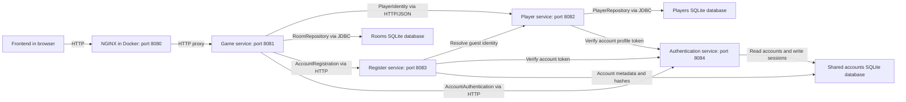
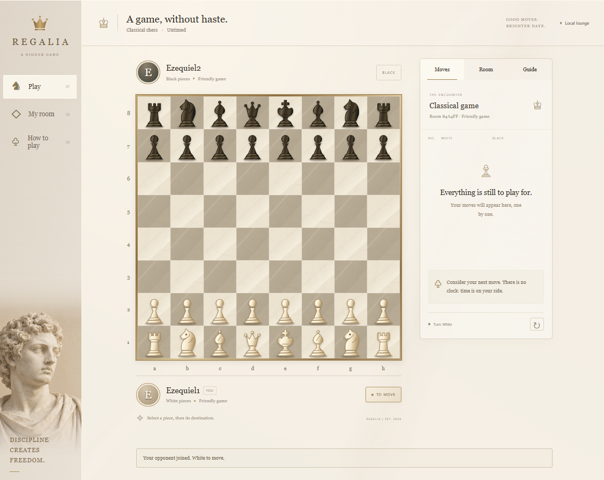
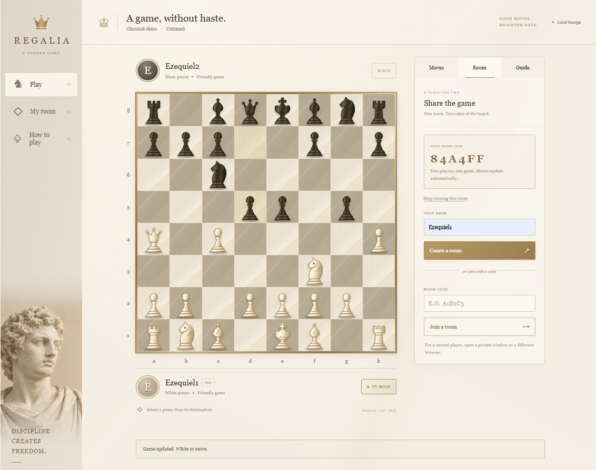
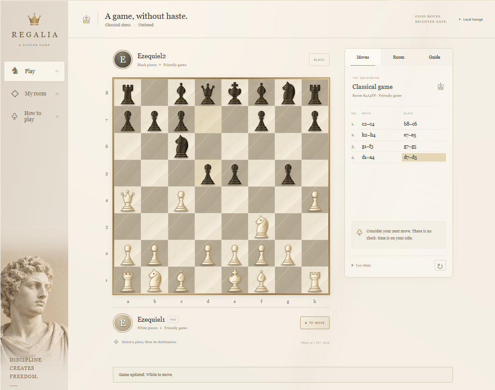

# Chess Software — Regalia

## Delivery objective

Build a chess application where two users connect through a shared room code, play alternating moves and consult their game history. The current delivery provides a browser interface, a Java backend, JSON communication and SQLite storage.

## Dependencies, build and execution

| Dependency | Version or use |
| --- | --- |
| JDK | 27 |
| Maven | Builds the six modules and resolves dependencies |
| Gson | 2.14.0, backend JSON serialization |
| Javalin | 7.2.4, HTTP servers |
| SLF4J Simple | 2.0.20, server logging |
| SQLite JDBC | 3.54.1.0, room, player and account storage |
| Password4j | 1.8.4, Argon2id password hashing in registration and verification in authentication |
| JUnit Jupiter | 5.11.4, automated tests only |
| Node.js | 24, optional frontend tests only; no frontend server or npm packages required |
| Docker and Compose | Builds and runs NGINX and four Java services; verified with Docker Desktop Linux containers on Windows |

From the repository root:

```bash
mvn compile
```

In IntelliJ, open the root `pom.xml`, select JDK 27 and reload Maven. The Java entry points are the `Main` classes in player-service, register-service, authentication-service and game-service. Use the repository root as their working directory. Compose starts all four services with NGINX and is the recommended browser setup.

For direct Java API development, start player-service, then register-service to initialize the account database, then authentication-service and game-service. The player and registration HTTP clients connect lazily, so their startup does not call back into authentication. Direct Java entry points default to loopback.

The default direct ports are 8082 for players, 8083 for registration, 8084 for authentication and 8081 for games. Player and game databases remain `.regalia/players.sqlite` and `.regalia/rooms.sqlite`; registration and authentication share `.regalia/accounts.sqlite`. Existing positional arguments retain their meaning. Player-service optionally accepts the authentication origin as its fourth argument, register-service as its fifth, and game-service accepts registration and authentication origins as its fifth and sixth arguments. Their defaults are `http://127.0.0.1:8083` and `http://127.0.0.1:8084` where applicable. These direct API runs do not host browser assets.

### Run the five containers

With Docker running in Linux-container mode and port 8080 available, run these commands from the repository root. The Java services are built inside Docker; this path does not require Java or Maven on the host:

```bash
docker compose config
docker compose up --build -d
docker compose exec nginx nginx -t
```

Open [Regalia through NGINX](http://127.0.0.1:8080) after the services finish starting. NGINX serves the frontend directly from its source directory and forwards `/api`, `/api/...`, `/games` and `/games/...` to `http://game-service:8081`. The game service calls `http://player-service:8082`. The internal player-service endpoints are not routed. Java remains responsible for sessions, profiles, rules and storage.

`compose.yaml` defines NGINX, game-service, player-service, register-service and authentication-service. The shared Dockerfile builds the four Java services with Maven and JDK 27 and packages each in its own Java 27 runtime target. Base images remain pinned by digest. `.dockerignore` includes the required POMs and service sources; the frontend remains a read-only mount served by NGINX.

Only NGINX publishes a host port, bound to `127.0.0.1`. The four Java services listen on `0.0.0.0` inside their containers and use Compose DNS; their ports remain private. NGINX forwards `/api` and `/games` to game-service, including the new browser account routes. It does not publish the private `/accounts`, `/sessions` or `/players/current` endpoints.

| Volume | File in its owning container |
| --- | --- |
| `players-data` | `/data/players.sqlite`, written only by `player-service` |
| `rooms-data` | `/data/rooms.sqlite`, written only by game-service |
| `accounts-data` | `/data/accounts.sqlite`, shared by registration and authentication with separate table ownership |

Docker volumes are separate from direct Java `.regalia` files. Existing local databases are not imported automatically. All Java containers use the same non-root UID, allowing the two account services to access their shared volume. Registration creates the account schema; authentication starts after it and uses `restart: on-failure` if schema initialization has not finished. This is startup recovery, not a health check. Volumes preserve profiles, games, accounts and session digests across container recreation.

For a web entry point on port 8090, set this variable in PowerShell before starting Compose:

```powershell
$env:REGALIA_PORT = '8090'
docker compose up --build -d
```

Inspect or stop the deployment with:

```bash
docker compose ps
docker compose logs
docker compose down
```

`docker compose down` stops the containers while retaining their data volumes. The direct Java entry points default to `127.0.0.1`; the player-service third argument and game-service fourth argument optionally select another bind address. NGINX owns frontend hosting and HTTP forwarding; there is no separate Java gateway module.

## Delivery structure and main classes

```text
./
├── pom.xml
├── README.md
├── Dockerfile
├── compose.yaml
├── infrastructure/nginx/default.conf.template
├── chess-core/
│   ├── pom.xml
│   └── src/
│       ├── main/java/software/ulpgc/chess/
│       │   ├── application/domain/model/
│       │   ├── application/ports/
│       │   └── infrastructure/adapters/
│       └── test/java/software/ulpgc/chess/application/domain/model/
├── player-service/
│   ├── pom.xml
│   └── src/
│       ├── main/java/software/ulpgc/chess/playerservice/
│       │   ├── Main.java
│       │   ├── application/ports/
│       │   ├── application/usecases/
│       │   └── infrastructure/adapters/
│       ├── main/resources/player-schema.sql
│       └── test/java/software/ulpgc/chess/playerservice/
├── game-service/
│   ├── pom.xml
│   └── src/
│       ├── main/java/software/ulpgc/chess/gameservice/
│       │   ├── Main.java
│       │   ├── application/ports/
│       │   ├── application/usecases/
│       │   ├── infrastructure/adapters/
│       │   └── infrastructure/http/
│       ├── main/resources/schema.sql
│       └── test/java/software/ulpgc/chess/gameservice/
├── register-service/
│   ├── pom.xml
│   └── src/
│       ├── main/java/software/ulpgc/chess/registerservice/
│       │   ├── Main.java
│       │   ├── application/domain/model/
│       │   ├── application/ports/
│       │   ├── application/usecases/
│       │   └── infrastructure/adapters/
│       ├── main/resources/account-schema.sql
│       └── test/java/software/ulpgc/chess/registerservice/
├── authentication-service/
│   ├── pom.xml
│   └── src/
│       ├── main/java/software/ulpgc/chess/authenticationservice/
│       │   ├── Main.java
│       │   ├── application/domain/model/
│       │   ├── application/ports/
│       │   ├── application/usecases/
│       │   └── infrastructure/adapters/
│       ├── main/resources/authentication-schema.sql
│       └── test/java/software/ulpgc/chess/authenticationservice/
├── chess-frontend/
│   ├── pom.xml
│   └── src/
│       ├── main/resources/web/
│       │   ├── index.html
│       │   ├── style.css
│       │   ├── main.js
│       │   ├── app.js
│       │   ├── room-actions.js
│       │   ├── room-api.js
│       │   └── assets/
│       ├── test/java/software/ulpgc/chess/frontend/
│       └── test/javascript/
└── docs/screenshots/
```

`chess-core` defines the chess rules and data model and supports loading board positions from FEN. `player-service` resolves stable guest-player identities and stores public names in its own SQLite database. `game-service` executes room and game operations, manages sessions and stores matches. `chess-frontend` contains the board presentation, browser interactions and deployment checks. NGINX serves these assets and forwards public API requests to the game service.

`register-service` owns account metadata, password hashes and account status. `authentication-service` reads those records and owns authenticated sessions in the same account file. Both are included in Compose and are called by game-service through HTTP ports. The browser-facing backend and Account tab support registration, sign-in, sign-out and deactivation.

## System architecture



The browser uses one web origin served by NGINX. The game and player services run in separate Java processes using Javalin, with one container per service in Compose. When opening a session, the game service obtains its guest-player identity through the `PlayerIdentity` port and its HTTP adapter. The game service persists rooms in SQLite and manages active browser sessions in memory. The player service persists profile identifiers and names in a separate SQLite file and volume. Browser cookies let the original players reopen a saved room with its code after restarting the services.

Player identity resolution and profile-name operations remain separate from room coordination. Game-service now verifies account sessions before protected operations and permits guest access only while that player has no account. Existing HTML and JavaScript continue to support unregistered guests. Account controls are connected; matches-service extraction remains pending.

### Planned service boundaries

This table records the responsibility split. Player, game, registration and authentication processes are implemented and deployed through Compose. Backend account permissions and frontend account controls are connected; matches extraction remains pending.

| Component | Responsibility and data ownership |
| --- | --- |
| `player-service` | Stable player identifiers and public display names |
| `game-service` | Authoritative chess state, move validation, ordered move history and game result |
| `matches-service` | Room codes, White and Black seats, participant records, creation date and associated game identifier; lists matches and obtains their state and moves from `game-service` |
| `register-service` | Account creation and deactivation, account status and the association with a stable player identifier |
| `authentication-service` | Reads active accounts and password hashes and owns authenticated session rows in the shared account database |
| Frontend | Board presentation and user interaction through the service contracts |
| NGINX | Serves frontend files and routes HTTP requests to the services |

A participant record preserves the player identifier and display name used in that match. Account deactivation must end access while preserving recorded matches and moves. A display-name change must not rewrite the names recorded in earlier matches. Services identify the acting user from a verified session, rather than trusting a player identifier supplied by the frontend.

Services communicate through HTTP and JSON using application ports and infrastructure adapters. Each service controls writes to its own data; registration and authentication share the account file but write different tables. Until room and game storage have been separated with failure handling in place, the existing room-and-move transaction stays in `game-service`. NGINX handles HTTP forwarding and frontend hosting. Direct API checks belong to their Java service modules; frontend files and gateway behavior are checked through the Docker deployment tests in `chess-frontend`.

### Backend hexagonal architecture

| Role | Concrete packages and classes |
| --- | --- |
| Domain | `chess-core`: `application/domain/model`, including `Room`, `Game`, `State`, `Board`, `User` and `Move` |
| Use cases | `game-service/application/usecases`: `CreateRoomUseCase`, `GetRoomUseCase`, `JoinRoomUseCase`, `EnterRoomUseCase`, `MoveUseCase` |
| Storage port | `game-service/application/ports/RoomRepository` |
| Player identity port | `game-service/application/ports/PlayerIdentity`, implemented by `infrastructure/adapters/HttpPlayerService` |
| Player profile updates | `game-service/application/ports/PlayerProfileUpdater`, implemented by the same `HttpPlayerService` adapter; `PlayerProfileUseCases` validates names and preserves identity |
| Storage adapter | `infrastructure/adapters/SqliteRoomRepository` coordinates room metadata and the transaction; its package-private `SqliteGameHistory` reads and writes ordered moves and reconstructs `Game`. `SqliteDatabase` initializes storage and configures connections. Tests can use `InMemoryRoomRepository` |
| Incoming HTTP adapters | `infrastructure/adapters/RoomApiHandler`, `GameApiHandler` and `PlayerProfileApiHandler`, registered by `GameHttpServer` |
| Transport support | `infrastructure/http`: `RoomActionRequest`, `RoomJsonCodec`, `ApiMessages`, `FormData`, `HttpResponses` |
| Sessions | `infrastructure/adapters/BrowserSessions` |
| Player service | `player-service/application/usecases/ResolvePlayerUseCase` and `RenamePlayerUseCase`, exposed by `infrastructure/adapters/PlayerApiHandler` and `PlayerHttpServer` |
| Player storage | `player-service/application/ports/PlayerRepository`, implemented by `infrastructure/adapters/SqlitePlayerRepository` with `SqlitePlayerDatabase`. Tests can use `InMemoryPlayerRepository` |
| Web entry point | NGINX uses `infrastructure/nginx/default.conf.template` for HTTP forwarding and frontend resources |

Game-service package paths are relative to `software/ulpgc/chess/gameservice`. Its `Main` connects the collaborators through constructors. Storage-facing use cases depend on `RoomRepository`, while `EnterRoomUseCase` composes lookup and joining. Domain rules do not depend on HTTP, JSON or storage implementations.

Room coordination and chess operations remain separate use cases. Within SQLite, `SqliteRoomRepository` handles room identifiers, participant snapshots and the game reference, while `SqliteGameHistory` handles move order, promotion values and replay. The history component receives the repository's connection and does not open connections or commit independently. Both reads share one transaction so room metadata and moves describe the same stored version; both writes share one transaction so a rejected history write also rolls back the room. This internal separation keeps the existing schema and data and prepares later extraction without introducing another public repository contract.

`GameHttpServer` declares the Javalin routes, including `get("/games/{id}", ...)` and `post("/games", ...)`. Its handlers adapt the Javalin `Context` to the existing use cases. Room operations execute one at a time to preserve consistent updates. This follows the framework used in the classroom example.

### Account registration and storage

`register-service/application/domain/model/Account` represents account identity, a login username, the associated player identifier and `AccountStatus`. These packages are relative to `software/ulpgc/chess/registerservice`. An account starts `Active`; `deactivate()` returns an `Inactive` value with the same identifiers and username. `application/usecases/AccountUseCases` coordinates registration and persisted deactivation through `AccountRepository`, `PlayerIdentity` and `PasswordHasher`. `Main` injects their SQLite, HTTP and Argon2 adapters. The domain and use cases contain no Javalin, Gson, JDBC or Password4j types.

The username is separate from a public display name. It uses 3 to 40 ASCII letters, digits, dots, underscores or hyphens; surrounding whitespace is removed and letters are stored in lowercase. Thus `Alice` and `alice` identify the same login name. `HttpPlayerIdentity` resolves a stable player identifier through the existing private `/players/resolve` operation using the guest bearer credential. It validates that credential's canonical UUID format and the service response. Request fields named `id`, `playerId` or `status` do not select an account or player. Registration never copies a profile or rewrites a historical room participant.

`AccountRepository` inserts an account together with its encoded password hash, queries accounts and hashes, and deactivates an active account. `SqliteAccountRepository` uses prepared statements and one transaction for both registration writes. A credential-write failure rolls back the account insert. Account identifiers, normalized usernames and player associations are unique, including for inactive accounts. The database rejects concurrent duplicates even when both preliminary lookups found no account. Insertion does not replace a stored account, change its association or reactivate it. Missing matches return `Optional.empty()`; database failures and invalid stored values remain errors with their causes.

`Argon2PasswordHasher` encapsulates Password4j 1.8.4. Registration accepts passwords of 15 to 128 Unicode code points, preserving spaces and case. Each hash uses Argon2id version 19, 19456 KiB of memory, two iterations, parallelism one, a 32-byte output and an independent 16-byte random salt. The stored encoding includes the salt and parameters needed for verification. Plaintext passwords and guest credentials are not stored or returned. This follows the [OWASP password storage guidance](https://cheatsheetseries.owasp.org/cheatsheets/Password_Storage_Cheat_Sheet.html); the adapter uses the [Password4j library](https://github.com/Password4j/password4j).

`SqliteAccountDatabase.initializeSchema()` explicitly applies `register-service/src/main/resources/account-schema.sql` to `.regalia/accounts.sqlite` by default. Repeated initialization preserves accounts and adds `account_passwords` without changing old identifiers or statuses. That table references `accounts.id`, with foreign keys enabled for each connection. Legacy accounts without a hash remain unchanged and receive no default password; an explicit credential-enrollment process would be required to make them usable for authentication. Registration owns schema initialization, account metadata, password hashes and account status. Authentication reads these records from the same database and owns its session operations. The player reference has no cross-database foreign key and is resolved through the identity port. Existing game and player entry points never open this database.

Start the player service first, then run `software.ulpgc.chess.registerservice.Main` in IntelliJ with the repository root as its working directory. It defaults to `127.0.0.1:8083`, `.regalia/accounts.sqlite` and player origin `http://127.0.0.1:8082`. Optional arguments follow this order: `8093 .regalia/test-accounts.sqlite http://127.0.0.1:8092 127.0.0.1`. The final bind address defaults to loopback. The HTTP client and server close explicitly when the process stops.

The current registration routes are private service operations:

| Method and path | JSON fields | Successful result |
| --- | --- | --- |
| `POST /accounts` | `credential`, `username`, `password` | `201`, with generated `id`, normalized `username`, resolved `playerId` and `status: "Active"` |
| `DELETE /accounts/current` | `credential` and `password`, or `password` with an account bearer header | `200`, preserving the account and player identifiers with `status: "Inactive"` |

Both require `application/json` and accept at most 8192 bytes. Invalid input or JSON returns `400`, duplicate registration `409`, an incorrect password or unavailable active account during deactivation `401`, unsupported content `415`, an oversized body `413`, and an identity or storage failure `503`. Responses use JSON and `Cache-Control: no-store` and contain no password, hash or guest credential. Deactivation resolves the account through the credential's player and verifies its password; supplying another account identifier cannot choose the target. It retains the username, player association and password hash, and never deletes match data. Registration has no retry key: a lost acknowledgement can follow a committed account, and a repeated request then returns a conflict.

These private registration operations are not routed directly through NGINX. Game-service exposes a public adapter that obtains the guest credential from its own browser session or forwards a verified account token for deactivation. The browser never supplies either secret in JSON. The Account tab uses these public HTTP routes.

Verify the registration service and its test dependencies with:

```bash
mvn -pl register-service -am test
```

### Authentication and session lifecycle

`authentication-service` has its own `Main`, Javalin server, use cases and ports. Its production code has no Java dependency on `register-service`. `AccountCredentials` is a private read projection containing the account identifier, associated player identifier and encoded password hash; it does not duplicate the account entity or profile. `AccountCredentialsReader` exposes only the read needed for login. `PasswordVerifier` hides Password4j, `SessionRepository` controls session persistence and `SessionTokens` hides random token generation and digesting. Tests can substitute these ports and inject a clock.

Start registration first so that `.regalia/accounts.sqlite` contains `accounts` and `account_passwords`, then run `software.ulpgc.chess.authenticationservice.Main` from the repository root. It defaults to `127.0.0.1:8084` and the same account file. Optional arguments are `8094 .regalia/test-accounts.sqlite 127.0.0.1`. Authentication opens the file in SQLite `mode=rw`: a missing file or missing account schema fails startup rather than creating a second account store. It initializes only `authentication-service/src/main/resources/authentication-schema.sql`, which adds `authentication_sessions` and its indexes without rewriting existing accounts or hashes.

| Method and path | Input | Successful result |
| --- | --- | --- |
| `POST /sessions` | JSON `username` and `password` | `201` with a new `token`, `accountId`, stable `playerId` and absolute `expiresAt` |
| `GET /sessions/current` | `Authorization: Bearer <token>` | `200` with `accountId`, `playerId` and `expiresAt`; records current session activity |
| `DELETE /sessions/current` | `Authorization: Bearer <token>` | `204` with no body; revokes that session and can be repeated |

Login resolves an active account with stored credentials and verifies the exact password. Unknown users, inactive accounts, legacy accounts without a hash and wrong passwords receive the same `401` response. An unavailable account also performs a dummy Argon2id verification; this avoids skipping the expensive password operation, without promising identical response times. Supplied tokens, identifiers and expiry dates do not select or configure the resulting session. Different browsers can log in with the same account, receive independent tokens and recover the same recorded player identifier without the original guest cookie.

Tokens contain 32 bytes from `SecureRandom`, encoded as 43 canonical Base64url characters. SQLite stores only their SHA-256 digest, never the bearer token itself. This fast digest verifies a random secret; passwords continue to use Argon2id. The token is returned only by login and is accepted only in the Authorization header for session operations, not in a URL, body or cookie. Responses use `Cache-Control: no-store`, and session queries do not return tokens or password hashes. See the [OWASP session guidance](https://cheatsheetseries.owasp.org/cheatsheets/Session_Management_Cheat_Sheet.html).

Sessions have an absolute eight-hour lifetime and expire after thirty minutes without activity. Both boundaries are checked on the server; a successful session query refreshes activity but cannot extend the absolute deadline. Session creation atomically checks that the account is still active, saves the digest and removes expired, idle or inactive sessions. A failed insert rolls back that cleanup as well. Logout removes only the selected session. Session resolution checks the current account status in the same transaction as the activity update, so deactivation blocks every outstanding token on its next validation, including after an authentication-service restart. Inactive-session rows can remain until logout or the next successful login cleanup, but cannot authorize access. A storage failure returns `503` and never reports a successful login or logout.

Private login uses the same JSON and 8192-byte limits as registration, with `400`, `415` and `413` for malformed input, unsupported content and oversized bodies. Invalid bearer tokens return `401`; unavailable storage returns `503`. The public game-service adapter now handles browser cookies and verifies these sessions for protected game and profile operations. The Account tab provides the browser controls.

Verify authentication, registration compatibility and session recovery with:

```bash
mvn -pl authentication-service -am test
```

The private `GET /accounts/by-player/{playerId}` reports only whether an association exists, including inactive accounts. Storage errors remain `503` rather than an absent association. Game-service uses `AccountRegistration`, `AccountAuthentication` and `AccountPlayerProfiles`; their HTTP adapters validate remote responses and keep bearer tokens in Authorization headers.

### Browser account adapter and permissions

The new routes are implemented by game-service and are available through the existing NGINX `/api` proxy. The Account tab uses these routes. Browser requests use cookies automatically; JSON `token` always means the CSRF token, not the authenticated bearer token.

| Method and path | Input | Result |
| --- | --- | --- |
| `GET /api/session` | Browser cookies | Browser session state, `viewer`, CSRF `token`, `authenticated` and `requiresLogin` |
| `POST /api/accounts` | JSON `username`, `password`, `token` | `201`; registers the current guest and requires an explicit login |
| `POST /api/session` | JSON `username`, `password`, `token` | `201`; issues the account cookie and rotates the browser session and CSRF token |
| `DELETE /api/session` | JSON `token` | `200`; revokes the bound account session, clears its cookie and creates a fresh guest context |
| `DELETE /api/accounts/current` | JSON `password`, `token` | `200`; deactivates the verified account and clears its browser binding |

Load `/api/session` or `/api/state` before a write to obtain the browser's CSRF token. JSON content type, string fields and the 8192-byte limit are enforced. Missing browser sessions return `401`, mismatched CSRF tokens or foreign origins return `403`, duplicate accounts return `409`, invalid JSON returns `400`, unsupported content returns `415`, oversized bodies return `413` and unavailable services return `503`. A failed login preserves the current cookies, viewer and CSRF token. A service failure during initial session lookup does not issue a new control cookie. An expired account can still load `/api/session` to obtain a challenge for explicit logout or reauthentication; this does not authorize game or profile operations.

The existing `regalia` cookie identifies the browser control session. `regalia-account` holds the authenticated token. Both are `HttpOnly`, `SameSite=Lax` and scoped to `/`; HTTPS requests also receive `Secure`. The authenticated cookie expires no later than the granted absolute lifetime. Account login, logout and deactivation rotate the control cookie and CSRF token. Neither the guest credential nor the bearer token is returned in JSON, placed in a URL or intended for JavaScript storage. The public adapter uses the [synchronizer-token approach](https://cheatsheetseries.owasp.org/cheatsheets/Cross-Site_Request_Forgery_Prevention_Cheat_Sheet.html).

Every protected request validates its actor before a room, move, profile or account write. Guest access checks the original player association even after the game service restarts, so registering or deactivating an account blocks its previous guest credential. An invalid or expired account cookie never silently becomes a guest identity. Explicit logout creates a different guest identifier that has no historical seats for the former account. Public `GET /games/{id}` remains a read-only query by code, as documented previously.

Game-service retains its port-based account cases and HTTP clients. Player-service's private `GET` and `PUT /players/current` validate the bearer token through authentication before loading or updating that player's profile. Registration's bearer-authenticated deactivation does the same; its private `GET /accounts/by-player/{playerId}` is a read-only association lookup. Account identifiers or guest credentials supplied in browser JSON are not forwarded as authority. The internal `/players`, `/accounts` and `/sessions` routes remain inaccessible through NGINX.

Current-session names remain cached independently of the saved public profile. After login in another browser, `GET /api/profile` loads that profile without rewriting encounter names. Authenticated game access does not require a profile-service request on every poll. Browser-control activity is distinct from verified player activity: repeatedly loading a login challenge for an expired account cannot keep that player marked connected. The game service still caches control sessions, selected rooms and presence in one JVM; Consul and multi-instance game coordination remain pending.

### Using accounts in the browser

Open **Account** to create an account for the current guest or sign in with an existing username and password.
Registration preserves the current player and requires an explicit sign-in. Enter the password again to sign in;
password fields are cleared after each attempt and are never saved by the application in browser storage.
The saved public name is loaded separately and can be changed in **Room** without changing names in older games.
To return from another browser, sign in and join using the saved room code; the same player keeps their original seat.

**Sign out** revokes the current account session and starts a new guest identity. Keep the room code before leaving.
**Deactivate account** requires the password and an explicit confirmation checkbox. This blocks the account in every
browser and retains recorded participants and moves. Account creation is hidden while a previous identity requires
sign-in; **Continue as a new guest** explicitly clears that binding.

A rejected session locks room, move and profile controls and retains the current board and move history on screen.
The Account tab offers reauthentication or an explicit new guest. A fresh page loads session metadata before protected
game state. **Check session** recovers after a service failure; unavailable services never silently enable guest access.
An unconfirmed account write is followed by a session query, without automatically repeating the write. If that query
also fails, account writes remain disabled until the session can be checked. Unregistered guests can still play normally.

### Lightweight frontend architecture

| Role | Current implementation |
| --- | --- |
| UI | `index.html` templates, `style.css`, SVG assets and rendering functions in `app.js` |
| Interaction use cases | `RoomActions` in `room-actions.js` loads state, executes room actions, recovers after a rejected move and coordinates synchronization and account operations |
| Service boundary | `RoomActions` receives a service exposing room, profile and account operations. Room operations return snapshots; profile and account operations have their own responses |
| Communication adapter | `RoomApi` in `room-api.js`, using `fetch` and `response.json()` |
| Composition | `main.js` connects `RoomApi` to `RoomActions` and passes the actions to `startApp()` |

`app.js` handles browser events, square selection and rendering. `RoomActions` can run with a service double and without browser elements. The backend validates every submitted move.

## Communication contract

For an unregistered guest, game-service calls `POST /players/resolve` with the canonical UUID credential from its server-side browser session. The player identifier preserves the existing SHA-256 mapping and historical seats. The backend also asks registration whether that player has an account; registered and inactive players must authenticate rather than continue under the old guest credential. Failed registration lookups return `503` instead of granting guest access.

`PUT /players/name` on the player-service origin accepts JSON with `credential` and `name`, and returns the same identifier with the updated name. Names are trimmed and must contain between 1 and 40 characters. Invalid requests leave the previous name unchanged. This is an independent profile operation: creating or joining a room does not rename the profile. A new game-service session loads the saved profile name; existing sessions retain their current name. Names recorded in earlier rooms and games remain unchanged. Profiles are stored in `.regalia/players.sqlite` and retain their names and identifiers after the player service restarts. Storage failures return `503` and preserve the previous profile.

If the player service is unavailable, opening a new game-service session returns `503` without issuing a cookie or changing a game. Existing sessions can continue playing. The browser continues to communicate with the web server.

`GET /api/profile` loads the current player profile and refreshes its cached session name. `PUT /api/profile` accepts JSON with `name` and `token` and updates that profile. Both routes require a valid game-service session, initialized by `GET /api/state`, and return `{ "profile": { "id": "...", "name": "..." }, "token": "..." }`. The server obtains the guest credential or authenticated token from its session; supplied `id` or `credential` fields do not choose the target player. The browser never needs to read its HttpOnly cookie.

An absent or expired profile session returns `401` without issuing a new cookie. Invalid update tokens return `403`; invalid JSON or names return `400`; unsupported content types return `415`; oversized bodies return `413`; and unavailable or invalid player-service responses return `503`. Successful updates change the cached viewer name while preserving the session identity, token, room, board and recorded participants. After a failed acknowledgement, `GET /api/profile` can reload the actual saved name before a retry.

In the Room tab, use **Saved profile name** and **Save profile name** to persist your public name. **Name for this room** is a separate encounter name: creating or joining a room does not save the profile. The saved name prefills the encounter field until the user edits it, and existing games retain their recorded participant names. The frontend queries the saved profile after a failed update without automatically repeating the write. If that query also fails, saving remains disabled until **Load saved name** succeeds. Room synchronization continues independently of the player service.

`POST /games` creates a game from a JSON object containing `name` and the `token` obtained from `GET /api/state`. Send both requests with the same browser cookie. A successful response has status `201`, includes the game `id`, `room` and `pieces`, and provides its URL in the `Location` header. Invalid JSON or names return `400`, invalid tokens return `403`, oversized bodies return `413` and unsupported content types return `415`.

`GET /games/{id}` returns the stored game identifier, a `room` object with players, turn, result and move history, and the `pieces` map. The current application uses the room code as the game identifier. Anyone with the code can consult this read-only endpoint. For example, open `http://127.0.0.1:8080/games/ABC123` with an existing room code. A missing game returns `404`.

`PUT /games/{id}` records a move from JSON containing `token`, `from`, `to` and an optional `promotion`. Use the player's browser cookie and its token. For example, `{ "token": "...", "from": "e2", "to": "e4" }`. A successful response has status `200` and the same structure as the game query. The server validates membership, turn and chess rules before saving. Rejected moves return `400`, invalid tokens `403` and missing games `404`. JSON content and body limits match `POST /games`. All game routes are accessible directly on the game-service port or through the web server.

The frontend creates games with `POST /games` and sends moves with `PUT /games/{id}`, using JSON bodies. After either action, it loads `GET /api/state` to update the board, viewer and connection status. Joining, refreshing and leaving still use form fields through `POST /api/action`. JSON responses contain the players, board, turn and history, or an error message. The `presence` object reports `whiteConnected` and `blackConnected` while viewing a room. `room.inCheck` indicates that the player to move is in check. `room.winner` contains `White` or `Black` after checkmate and is otherwise `null`. `room.stalemate` is `true` after a draw by stalemate. A move can include a `promotion` choice of `queen`, `rook`, `bishop` or `knight`. Supplied choices appear in the move history. The server defaults to a queen when a pawn promotes without a choice.

## Data model and connecting users

| Model | Data and relationships |
| --- | --- |
| `User` | Identifier and name; no authenticated account |
| `Room` | Shared code, White user, optional Black user and one game |
| `Game` | Identifier, current `State` and immutable list of moves |
| `State` | Board, current turn, optional en passant target and castling rights |
| `Board` | Immutable mapping from `Square` to `Piece` |
| `Move` | Origin, destination and optional promotion choice |

At startup, `Main` initializes `SqliteDatabase` with `game-service/src/main/resources/schema.sql` and passes it to the repository. SQLite stores the room code, game identifier, players and creation time in `rooms`. The `moves` table stores the ordered moves and their optional promotion choices. Loading a game checks that move numbering starts at one without gaps and replays those moves to reconstruct its board, turn and result. A single transaction saves each room update and its history.

The player service initializes `player-service/src/main/resources/player-schema.sql` explicitly at startup. The `players` table contains only `id` and `name`; it does not store the browser credential or write the room database. A saved profile can be queried through `POST /players/resolve` with its original credential. Generated database files are excluded from Git.

The creator receives a six-character room code and plays White. The second user enters that code and plays Black. A third player is rejected. For local testing, use a normal and a private browser window. Tabs in one profile share the same session. Click a piece and then a destination. Players, turns and moves update automatically by requesting the current state every two seconds while viewing a room. A player appears disconnected after 15 seconds without an API request or when they stop viewing the room. Their seat and move history are preserved. Refresh remains available for an immediate check.

The server rejects moves that leave the moving player's king in check or attempt to capture the opposing king. Both players see which king is in check and can review the final position and move history after checkmate or stalemate. When a pawn reaches its last rank, the browser asks the player to choose a promotion piece. En passant is available on the immediate reply to an opposing pawn's double step. To castle, select the king and move it two squares toward the rook. The server checks castling rights, the path and the king's safety.

### Room, game and identity contracts

These contracts describe the current application and the constraints for separating matches from games. Matches-service remains planned. Registration, authentication, the public backend account adapter and the HTML account controls are implemented.

| Concept | Identity and guarantees |
| --- | --- |
| Room | `Room.code()` identifies the shared encounter and its two seats. Creating a room assigns White; entering with a different player can assign Black. Reopening with an existing participant preserves that participant, game and history. |
| Game | `Game.id()` identifies the chess game; `State` and ordered `Move` values determine its position and result. Current creation uses the room code as the game identifier, and `/games/{id}` currently looks up that room code. Existing identifiers and URLs must remain usable during extraction. |
| Participant | The `User` stored in `Room.white()` or `Room.black()` records a stable player identifier and the name used when taking that seat. Membership compares identifiers; a matching name grants no membership. A profile rename cannot replace this historical value. |
| Profile | `player-service` owns the current public name for a stable `User.id()`. Its name may differ from the names in recorded encounters. The player repository never writes rooms or moves. |
| Acting player | The backend verifies the account cookie through authentication or resolves an unregistered guest. Writes also require that browser session's CSRF token. Browser-supplied identifiers, credentials or another session's token cannot select the actor. |
| Viewed room | The session's current room selects the board returned by `/api/state` and affects presence. It does not allocate a seat or define membership in other rooms. A participant can submit a legal move to a room they belong to while viewing another room. |
| Account | Registration preserves a stable player association. Game-service verifies its authenticated session before protected operations. Registration, logout and deactivation cannot restore historical account permissions through the former guest credential. The remaining UI work does not change these server checks. |

`User` is the existing immutable identifier-and-name value used for both profiles and historical participants. These roles do not require duplicate `Player` or `Participant` classes at this stage. A distinct actor type or internal service port will be introduced when an implemented use case needs its contract.

| Operation | Preconditions and result | Rejection and failure guarantees |
| --- | --- | --- |
| Create | A valid creator and an unused room code produce a waiting room and initial game in one local save. | Invalid input or an explicit duplicate code leaves existing rooms unchanged. The current public `POST /games` generates a code; it has no retry key and must not be described as idempotent. |
| Enter or reopen | A non-member can take the free Black seat. `EnterRoomUseCase` returns the existing room for an already seated identifier, even if its current profile name differs. | A third player or missing room is rejected without assigning a seat or changing the game. Direct `Room.join` remains stricter and rejects an identifier already seated. |
| Move | The acting identifier must occupy a seat, both players must be present in the room model, its color must have the turn and the move must satisfy the chess rules. | A rejected move preserves participants, position, turn and history. Possessing a room code or a valid token for another session does not authorize a move. Online presence is not an additional chess permission. |
| Query a game | `GET /games/{id}` returns the game for a known code without joining, creating a session or changing the viewer's selected room. | A missing game returns `404` and does not create one. The current read policy allows anyone with the code to consult this endpoint; changing that policy belongs to the account and history work. |
| Query viewer state | `/api/state` returns the selected room or a board preview, and manages the browser session and presence. | This operation can initialize a session; it does not create a room, record a move or perform hidden room recovery. |
| Update profile | An active session, its token and a valid name select the session's player profile. A valid service response refreshes that session's cached name. | Identity and historical participants remain unchanged. A lost acknowledgement may follow a successful remote write; query `/api/profile` before another attempt rather than claiming that the remote write was rolled back. |

`RoomRepository.save` is currently the persistence boundary for both the room and its complete move history. SQLite commits these values together and rolls back a failed write. `Main` injects that repository into the use cases. The HTTP server serializes operations within one process; the repository port currently provides no compare-and-set version or multi-process coordination guarantee. Running more game-service replicas therefore requires additional session and concurrency work.

Examples checked by the current contracts:

| Situation | Expected result |
| --- | --- |
| Alice saves a new profile name and reopens an earlier room | Same player identifier and seat; the room retains its original participant name and moves. |
| Another identifier uses the name Alice | The name gives no authority over Alice's games. |
| Bob belongs to room A and sends his valid token plus Alice's claimed `userId` to move in room B | Rejected with `400`; both rooms and both existing viewer states are preserved. |
| Bob sends Alice's token with Bob's browser cookie | Rejected with `403`; the token is bound to its own session. |
| Alice belongs to rooms A and B, views B, then submits a legal move to A | Only A's game advances; B stays selected and unchanged, and A retains its recorded participants. |
| A game response is lost after a move may have been saved | Read the game and ordered history before retrying. The current move endpoint has no operation-key deduplication contract. |

`GameHttpIntegrationTest.movingUsesRoomMembershipRatherThanTheViewedRoomOrClaimedPlayerIdentity` checks the two-room cases. The existing room use-case, repository, profile and HTTP checks cover reopening, historical names, rejected writes and read-only game queries.

### Planned ownership and extraction sequence

The target owner of room codes, seats, participant snapshots, encounter creation time and the game reference is `matches-service`. `game-service` will own chess state, moves and result, and must have a verified assignment of the player identifier authorized for each color. `player-service` remains the profile owner. Until the extraction is implemented, the current `Room` aggregate and the room-and-move transaction remain together in `game-service`.

Participant assignment in a future game-service boundary will be an authenticated internal operation. Public clients will not configure authorized players by supplying identifiers. The inbound adapter must resolve a verified actor before invoking an application operation; internal authentication and the concrete port will be selected when those callers are implemented. Reads must not trigger internal participant updates or acquire cross-service locks.

The planned application-level operations at that boundary are:

| Planned operation | Required input | Guarantee |
| --- | --- | --- |
| Create a game | Stable operation key, requested game identifier and the reserved White player identifier, from the trusted encounter coordinator | The same key and payload return the same game. A conflicting key or payload cannot replace an existing game or White assignment. |
| Assign Black | Stable operation key, game identifier and the reserved Black player identifier, from the trusted encounter coordinator | White and Black must differ. Black is assigned once; replaying the same completed operation returns its outcome, while another player cannot replace the occupied seat. |
| Read a game | Game identifier and the actor required by the eventual read policy | Return the game, assigned player identifiers, current state and ordered history without changing seats or recovering pending operations. |
| Submit a move | Game identifier, server-verified acting player, move, expected move count and stable operation key | Check membership, turn, expected state and chess rules. A repeated completed operation returns its outcome; a conflicting state or payload is rejected without appending another move. |

These requirements belong to the future extraction. They do not add endpoints or promise operation-key support in the current HTTP API.

The migration must preserve these steps:

1. Prepare separate room-coordination and game-access operations inside the current process, keeping the same transaction and behavior. No service may start writing another service's tables.
2. Preserve the mapping between every existing room code and game identifier, participant identifiers and recorded names, creation time and ordered moves. Historical names come from the stored room, not the current profile. Any schema or identifier change needs an explicit, versioned migration; existing files and Docker volumes must not be deleted or silently replaced.
3. Before distributing creation or joining, implement stable operation keys, retry handling and a visible incomplete state when necessary. A retry with the same key and payload must return the same outcome; a conflicting payload must be rejected. Reserve a seat once, and never report a room as ready until its game and authorized participants agree.
4. Verify failures after game creation, after seat reservation and after a write whose response is lost. A retry or explicit recovery must complete or report the incomplete operation without duplicate games, changed seats or lost moves. Queries stay read-only. Cut over to one writer per data set only after this behavior and a recovery procedure have been checked; retain the previous storage for recovery during the migration.

These are extraction requirements, not guarantees already offered by independent services. Registration will first provide the account-to-player association needed for the planned authenticated actor. The current local transaction remains authoritative until distributed failure handling is implemented and verified.

## Incorporated idea

Players can reopen a room with its shared code and continue their game, even after restarting the server. Use the original browser sessions and keep their cookies to retain each player's seat. After restarting, reload Regalia and join again with the room code.

## Required screenshots

User-provided captures from room `84A4FF`, with Ezequiel1 playing White and Ezequiel2 playing Black. These captures show an earlier game recorded before SQLite storage was added.

Board with both players:



Room and shared code:



Game with recorded moves:



## Verification

Run the Java checks that do not require Docker from the repository root:

```bash
mvn test
```

The Java suites contain 200 cases: 195 without Docker and five opt-in deployment checks. The new coverage includes eight public account-permission HTTP scenarios against the four independent services and a malformed account-response adapter check. They cover registration, cookie and CSRF handling, historical identity and names, login in another browser, restart recovery, logout with a missing account cookie, expiry, deactivation, legacy-route bypass attempts, failed dependencies and rejected writes. The five Docker checks cover frontend assets, proxy contracts, guest recovery, service failures and account login/profile/history recovery after recreating account and game containers. The existing 33 direct game API cases, 32 registration cases, 17 authentication cases, chess rules and repository contracts remain in the suite.

To verify the disconnection notice, set one browser window to Offline in its developer tools. Wait for the other player to see the notice, then restore the connection. Both players can continue with the same turn and move history.

Run the thirteen frontend interaction and HTTP adapter tests with Node.js 24:

```bash
node --test chess-frontend/src/test/javascript/*.test.mjs
```

Seven account checks cover control-session recovery, CSRF rotation shared with game writes, public request contracts, malformed metadata, expired access, lost acknowledgements and stale synchronization. Six profile checks cover profile responses without board data, explicit profile writes, separate encounter names, lost acknowledgements, rejected names and stale background responses. Browser checks cover registration, wrong-password rejection, sign-out, sign-in from another cookie context, account deactivation observed by another session, saved board and history during access loss, authentication failure and recovery, desktop and 390-pixel mobile layouts, saving and reloading a profile, preserving an edited encounter name and historical participants, rejecting a blank name, recovering after a player-service restart and the mobile layout.

With Docker running, enable the five Java deployment checks:

```bash
mvn -Dregalia.docker.tests=true test
```

`DockerDeploymentIntegrationTest` in `chess-frontend` creates its own Compose project, selects a free local port, builds and starts all five containers and checks the generated NGINX configuration. It verifies markup, JavaScript MIME types, piece assets, separation of player text from the HTML document, browser cookies, room creation and joining, moves, profiles, historical names, `Location` and `Allow`, rejected requests and the 8192-byte body boundary. It recreates the player and game containers for guest recovery, and the account and game containers for authenticated recovery. Both paths preserve the recorded participants, profile and moves and allow play to continue. A stopped game service and a paused, unresponsive game service both produce JSON with status `503`; the frontend remains accessible. The test removes only its own containers and temporary data volumes, and leaves command logs under `chess-frontend/target/docker-check-*`. Its Java test dependencies are test-scoped; the frontend runtime remains HTML, CSS and JavaScript. Python is not required to build, run or verify this deployment.

A manual walkthrough with a normal browser window and a private window also confirmed saved profiles, shared rooms, alternating turns, rejected moves, preserved historical participant names and continued play after restarting both Java services. Stopping and starting the game service preserved the recorded moves and allowed the players to reopen their room.

To verify the frontend service boundary, open Regalia and run this in the browser console. The test service should log `null` and `DEMO01` and send no API requests for these calls.

```javascript
const { RoomActions } = await import('/room-actions.js');
const preview = { viewer: { id: 'demo', name: 'Guest' }, room: null, pieces: new Map() };
const actions = new RoomActions({
  state: async () => preview,
  action: async (action, { name }) => {
    if (action !== 'create') throw new Error('Unexpected action');
    const viewer = { ...preview.viewer, name };
    return { ...preview, viewer, room: { code: 'DEMO01', turn: 'White', white: viewer, black: null, moves: [] } };
  }
});
console.log((await actions.load()).room);
console.log((await actions.perform('create', { name: 'Alice' })).room.code);
```


Browser verification with two independent sessions confirmed JSON creation and moves, recovery after an invalid move, automatic synchronization, leaving and rejoining, and promotion to a knight. The three `Main` classes were also run as independent processes: both players retained their identities and continued a saved game after all processes restarted. In browser developer tools, the Network panel should show `POST /games` when creating a room and `PUT /games/{id}` when moving, both with JSON bodies. A selected piece remains selected across unchanged state checks.
