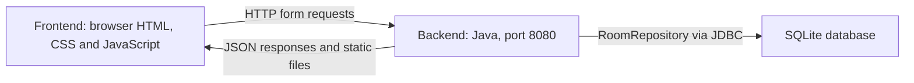

# Chess Software — Regalia

## Delivery objective

Build a chess application where two users connect through a shared room code, play alternating moves and consult their game history. The current delivery provides a browser interface, a Java backend, JSON communication and SQLite storage.

## Dependencies, build and execution

| Dependency | Version or use |
| --- | --- |
| JDK | 27 |
| Maven | Builds the three modules and resolves dependencies |
| Gson | 2.14.0, backend JSON serialization |
| SQLite JDBC | 3.54.1.0, local game storage |
| JUnit Jupiter | 5.11.4, automated tests only |

From the repository root:

```bash
mvn compile
```

In IntelliJ, open the root `pom.xml`, select JDK 27, reload Maven and run `software.ulpgc.chess.backend.Main` using the `chess-backend` module. Open [Regalia](http://127.0.0.1:8080) in the browser.

The Java server listens on `127.0.0.1:8080` and serves the frontend and API. It creates `.regalia/rooms.sqlite` in the working directory on first launch. To select a different local port and database file, set the IntelliJ program arguments to a port followed by a file path, for example `8081 .regalia/test.sqlite`.

## Delivery structure and main classes

```text
./
├── pom.xml
├── README.md
├── chess-core/
│   ├── pom.xml
│   └── src/
│       ├── main/java/software/ulpgc/chess/
│       │   ├── application/domain/model/
│       │   ├── application/ports/
│       │   └── infrastructure/adapters/
│       └── test/java/software/ulpgc/chess/application/domain/model/
├── chess-backend/
│   ├── pom.xml
│   └── src/
│       ├── main/java/software/ulpgc/chess/backend/
│       │   ├── Main.java
│       │   ├── application/ports/
│       │   ├── application/usecases/
│       │   ├── infrastructure/adapters/
│       │   └── infrastructure/http/
│       └── test/java/software/ulpgc/chess/backend/
├── chess-frontend/
│   ├── pom.xml
│   └── src/main/resources/web/
│       ├── index.html
│       ├── style.css
│       ├── main.js
│       ├── app.js
│       ├── room-actions.js
│       ├── room-api.js
│       └── assets/
└── docs/screenshots/
```

`chess-core` defines the chess rules and data model and supports loading board positions from FEN. `chess-backend` manages rooms and games and handles browser requests. `chess-frontend` displays the board, players and move history and lets users interact with the game.

## System architecture



The frontend and backend share one origin. The backend persists rooms in SQLite and manages the active browser sessions in memory. Browser cookies let the original players reopen a saved room with its code after a server restart.

### Backend hexagonal architecture

| Role | Concrete packages and classes |
| --- | --- |
| Domain | `chess-core`: `application/domain/model`, including `Room`, `Game`, `State`, `Board`, `User` and `Move` |
| Use cases | `chess-backend/application/usecases`: `CreateRoomUseCase`, `GetRoomUseCase`, `JoinRoomUseCase`, `EnterRoomUseCase`, `MoveUseCase` |
| Storage port | `chess-backend/application/ports/RoomRepository` |
| Storage adapter | `infrastructure/adapters/SqliteRoomRepository`. Tests can use `InMemoryRoomRepository` |
| Incoming HTTP adapter | `infrastructure/adapters/RoomApiHandler`, registered by `RoomHttpServer` |
| Transport support | `infrastructure/http`: `RoomActionRequest`, `RoomJsonCodec`, `ApiMessages`, `FormData`, `HttpResponses` |
| Session and asset adapters | `infrastructure/adapters/BrowserSessions`, `StaticAssetHandler` |

Package paths in the backend are relative to `software/ulpgc/chess/backend`. `Main` connects the collaborators through constructors. Storage-facing use cases depend on `RoomRepository`, while `EnterRoomUseCase` composes lookup and joining. Domain rules do not depend on HTTP, JSON or storage implementations.

### Lightweight frontend architecture

| Role | Current implementation |
| --- | --- |
| UI | `index.html` templates, `style.css`, SVG assets and rendering functions in `app.js` |
| Interaction use cases | `RoomActions` in `room-actions.js` loads state, executes room actions, recovers after a rejected move and coordinates synchronization |
| Service boundary | `RoomActions` receives a service with `state()` and `action(action, fields)`. Both return a snapshot on success |
| Communication adapter | `RoomApi` in `room-api.js`, using `fetch` and `response.json()` |
| Composition | `main.js` connects `RoomApi` to `RoomActions` and passes the actions to `startApp()` |

`app.js` handles browser events, square selection and rendering. `RoomActions` can run with a service double and without browser elements. The backend validates every submitted move.

## Communication contract

The frontend uses `GET /api/state` to retrieve the game state and `POST /api/action` to create or join a room, move, refresh or leave. Requests use form fields. JSON responses contain the players, board, turn and history, or an error message. The `presence` object reports `whiteConnected` and `blackConnected` while viewing a room. `room.inCheck` indicates that the player to move is in check. `room.winner` contains `White` or `Black` after checkmate and is otherwise `null`. `room.stalemate` is `true` after a draw by stalemate. A move can include a `promotion` choice of `queen`, `rook`, `bishop` or `knight`. Supplied choices appear in the move history. The server defaults to a queen when a pawn promotes without a choice.

## Data model and connecting users

| Model | Data and relationships |
| --- | --- |
| `User` | Identifier and name; no authenticated account |
| `Room` | Shared code, White user, optional Black user and one game |
| `Game` | Identifier, current `State` and immutable list of moves |
| `State` | Board, current turn, optional en passant target and castling rights |
| `Board` | Immutable mapping from `Square` to `Piece` |
| `Move` | Origin, destination and optional promotion choice |

The backend loads `chess-backend/src/main/resources/schema.sql` at startup. SQLite stores the room code, game identifier, players and creation time in `rooms`. The `moves` table stores the ordered moves and their optional promotion choices. Loading a game replays those moves to reconstruct its board, turn and result. A single transaction saves each room update and its history.

The creator receives a six-character room code and plays White. The second user enters that code and plays Black. A third player is rejected. For local testing, use a normal and a private browser window. Tabs in one profile share the same session. Click a piece and then a destination. Players, turns and moves update automatically by requesting the current state every two seconds while viewing a room. A player appears disconnected after 15 seconds without an API request or when they stop viewing the room. Their seat and move history are preserved. Refresh remains available for an immediate check.

The server rejects moves that leave the moving player's king in check or attempt to capture the opposing king. Both players see which king is in check and can review the final position and move history after checkmate or stalemate. When a pawn reaches its last rank, the browser asks the player to choose a promotion piece. En passant is available on the immediate reply to an opposing pawn's double step. To castle, select the king and move it two squares toward the rook. The server checks castling rights, the path and the king's safety.

## Incorporated idea

Players can reopen a room with its shared code and continue their game, even after restarting the server. Use the original browser sessions and keep their cookies to retain each player's seat. After restarting, reload Regalia and join again with the room code.

## Required screenshots

User-provided captures from room `84A4FF`, with Ezequiel1 playing White and Ezequiel2 playing Black. These captures show an earlier game recorded before SQLite storage was added.

Board with both players:


Room and shared code:


Game with recorded moves:


## Verification

Run all automated checks from the repository root:

```bash
mvn test
```

The latest run passed 83 tests. The same repository contract tests run against SQLite and in-memory storage. The SQLite tests also cover a database path that fails to open, rollback after a write failure and reopening a saved game after restart. To reproduce the restart check, play two moves, note the room code, restart the backend and rejoin with that code in the original browser windows. Both players should see the same board, turn and history and be able to continue.

To verify the disconnection notice, set one browser window to Offline in its developer tools. Wait for the other player to see the notice, then restore the connection. Both players can continue with the same turn and move history.

To verify the frontend service boundary, open Regalia and run this in the browser console. The test service should log `null` and `DEMO01` and send no API requests for these calls.

```javascript
const { RoomActions } = await import('/room-actions.js');
const preview = { viewer: { id: 'demo', name: 'Guest' }, room: null, pieces: new Map() };
const actions = new RoomActions({
  state: async () => preview,
  action: async (action, { name }) => {
    if (action !== 'create') throw new Error('Unexpected action');
    const viewer = { ...preview.viewer, name };
    return { ...preview, viewer, room: { code: 'DEMO01', turn: 'White', white: viewer, black: null, moves: [] } };
  }
});
console.log((await actions.load()).room);
console.log((await actions.perform('create', { name: 'Alice' })).room.code);
```


Automatic synchronization was also checked with two independent sessions: the creator detected the joining opponent, both clients received `e2-e4` and `e7-e5`, and neither needed manual refresh. A selected piece remained selected across unchanged state checks.
