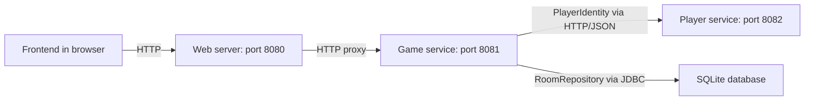

# Chess Software — Regalia

## Delivery objective

Build a chess application where two users connect through a shared room code, play alternating moves and consult their game history. The current delivery provides a browser interface, a Java backend, JSON communication and SQLite storage.

## Dependencies, build and execution

| Dependency | Version or use |
| --- | --- |
| JDK | 27 |
| Maven | Builds the five modules and resolves dependencies |
| Gson | 2.14.0, backend JSON serialization |
| Javalin | 7.2.4, HTTP servers |
| SLF4J Simple | 2.0.20, server logging |
| SQLite JDBC | 3.54.1.0, local game storage |
| JUnit Jupiter | 5.11.4, automated tests only |

From the repository root:

```bash
mvn compile
```

In IntelliJ, open the root `pom.xml`, select JDK 27 and reload Maven. Use the repository root as the working directory for all three run configurations.

1. Run `software.ulpgc.chess.playerservice.Main` using the `player-service` module. It listens on `127.0.0.1:8082` and resolves stable guest-player identities.
2. Run `software.ulpgc.chess.gameservice.Main` using the `game-service` module. It listens on `127.0.0.1:8081`, uses the player service and creates `.regalia/rooms.sqlite` on first launch.
3. Run `software.ulpgc.chess.backend.Main` using the `chess-backend` module. It serves the frontend on `127.0.0.1:8080` and forwards API requests to the game service.
4. Open [Regalia](http://127.0.0.1:8080) in the browser. Keep all three programs running while playing.

For different ports, start the player service with `8092`, the game service with `8091 .regalia/test.sqlite http://127.0.0.1:8092`, and the web server with `8090 http://127.0.0.1:8091`. SQLite files and browser identities from the previous version remain compatible.

## Delivery structure and main classes

```text
./
├── pom.xml
├── README.md
├── chess-core/
│   ├── pom.xml
│   └── src/
│       ├── main/java/software/ulpgc/chess/
│       │   ├── application/domain/model/
│       │   ├── application/ports/
│       │   └── infrastructure/adapters/
│       └── test/java/software/ulpgc/chess/application/domain/model/
├── player-service/
│   ├── pom.xml
│   └── src/
│       ├── main/java/software/ulpgc/chess/playerservice/
│       │   ├── Main.java
│       │   ├── application/usecases/
│       │   └── infrastructure/adapters/
│       └── test/java/software/ulpgc/chess/playerservice/
├── game-service/
│   ├── pom.xml
│   └── src/
│       ├── main/java/software/ulpgc/chess/gameservice/
│       │   ├── Main.java
│       │   ├── application/ports/
│       │   ├── application/usecases/
│       │   ├── infrastructure/adapters/
│       │   └── infrastructure/http/
│       ├── main/resources/schema.sql
│       └── test/java/software/ulpgc/chess/gameservice/
├── chess-backend/
│   ├── pom.xml
│   └── src/
│       ├── main/java/software/ulpgc/chess/backend/
│       │   ├── Main.java
│       │   └── infrastructure/
│       └── test/java/software/ulpgc/chess/backend/
├── chess-frontend/
│   ├── pom.xml
│   └── src/main/resources/web/
│       ├── index.html
│       ├── style.css
│       ├── main.js
│       ├── app.js
│       ├── room-actions.js
│       ├── room-api.js
│       └── assets/
└── docs/screenshots/
```

`chess-core` defines the chess rules and data model and supports loading board positions from FEN. `player-service` resolves stable guest-player identities. `game-service` executes room and game operations, manages sessions and stores matches. `chess-backend` serves the page and forwards HTTP requests. `chess-frontend` displays the board, players and move history and lets users interact with the game.

## System architecture



The browser uses the web server as its origin. The web server, game service and player service run in separate Java processes using Javalin. When opening a session, the game service obtains its guest-player identity through the `PlayerIdentity` port and its HTTP adapter. The game service persists rooms in SQLite and manages active browser sessions in memory. Browser cookies let the original players reopen a saved room with its code after restarting the services.

Player identity resolution has been extracted. Display names, room coordination and browser sessions remain in `game-service` during this step. Matches, registration and authentication services, together with NGINX routing, are pending.

### Planned service boundaries

This is the target for the next extractions. The current executable system uses the three processes described above; player-service display-name management is still pending.

| Component | Responsibility and data ownership |
| --- | --- |
| `player-service` | Stable player identifiers and public display names |
| `game-service` | Authoritative chess state, move validation, ordered move history and game result |
| `matches-service` | Room codes, White and Black seats, participant records, creation date and associated game identifier; lists matches and obtains their state and moves from `game-service` |
| `register-service` | Account creation and deactivation, account status and the association with a stable player identifier |
| Authentication service | Checks active accounts and credentials and manages authenticated sessions; shares the account database with `register-service`, as discussed in class |
| Frontend | Board presentation and user interaction through the service contracts |
| NGINX | Serves frontend files and routes HTTP requests to the services |

A participant record preserves the player identifier and display name used in that match. Account deactivation must end access while preserving recorded matches and moves. A display-name change must not rewrite the names recorded in earlier matches. Services identify the acting user from a verified session, rather than trusting a player identifier supplied by the frontend.

Services communicate through HTTP and JSON using application ports and infrastructure adapters. Each service controls writes to its own data; registration and authentication share account storage. Until room and game storage have been separated with failure handling in place, the existing room-and-move transaction stays in `game-service`. The current `chess-backend` forwarding and file-serving responsibilities will be replaced by NGINX when that routing is implemented.

### Backend hexagonal architecture

| Role | Concrete packages and classes |
| --- | --- |
| Domain | `chess-core`: `application/domain/model`, including `Room`, `Game`, `State`, `Board`, `User` and `Move` |
| Use cases | `game-service/application/usecases`: `CreateRoomUseCase`, `GetRoomUseCase`, `JoinRoomUseCase`, `EnterRoomUseCase`, `MoveUseCase` |
| Storage port | `game-service/application/ports/RoomRepository` |
| Player identity port | `game-service/application/ports/PlayerIdentity`, implemented by `infrastructure/adapters/HttpPlayerIdentity` |
| Storage adapter | `infrastructure/adapters/SqliteRoomRepository`, with `SqliteDatabase` for initialization and configured connections. Tests can use `InMemoryRoomRepository` |
| Incoming HTTP adapters | `infrastructure/adapters/RoomApiHandler` and `GameApiHandler`, registered by `GameHttpServer` |
| Transport support | `infrastructure/http`: `RoomActionRequest`, `RoomJsonCodec`, `ApiMessages`, `FormData`, `HttpResponses` |
| Sessions | `infrastructure/adapters/BrowserSessions` |
| Player service | `player-service/application/usecases/ResolvePlayerUseCase`, exposed by `infrastructure/adapters/PlayerApiHandler` and `PlayerHttpServer` |
| Web entry point | `chess-backend` uses `GameServiceProxy` for HTTP forwarding and `StaticAssetHandler` for frontend resources |

Game-service package paths are relative to `software/ulpgc/chess/gameservice`. Its `Main` connects the collaborators through constructors. Storage-facing use cases depend on `RoomRepository`, while `EnterRoomUseCase` composes lookup and joining. Domain rules do not depend on HTTP, JSON or storage implementations.

`GameHttpServer` declares the Javalin routes, including `get("/games/{id}", ...)` and `post("/games", ...)`. Its handlers adapt the Javalin `Context` to the existing use cases. Room operations execute one at a time to preserve consistent updates. This follows the framework used in the classroom example.

### Lightweight frontend architecture

| Role | Current implementation |
| --- | --- |
| UI | `index.html` templates, `style.css`, SVG assets and rendering functions in `app.js` |
| Interaction use cases | `RoomActions` in `room-actions.js` loads state, executes room actions, recovers after a rejected move and coordinates synchronization |
| Service boundary | `RoomActions` receives a service with `state()` and `action(action, fields)`. Both return a snapshot on success |
| Communication adapter | `RoomApi` in `room-api.js`, using `fetch` and `response.json()` |
| Composition | `main.js` connects `RoomApi` to `RoomActions` and passes the actions to `startApp()` |

`app.js` handles browser events, square selection and rendering. `RoomActions` can run with a service double and without browser elements. The backend validates every submitted move.

## Communication contract

The game service calls `POST /players/resolve` on the player-service origin with a JSON `credential` containing the browser's canonical UUID cookie value. The response contains `id` and `name`, currently `Guest`. The identifier preserves the previous SHA-256 mapping, so existing players keep their seats after the extraction. The player service stores no credentials or profiles in this step. Invalid credentials or JSON return `400`; unsupported methods, content types and oversized bodies return `405`, `415` and `413`. This is guest identity resolution; account authentication is pending.

If the player service is unavailable, opening a new game-service session returns `503` without issuing a cookie or changing a game. Existing sessions can continue playing. The browser continues to communicate with the web server.

`POST /games` creates a game from a JSON object containing `name` and the `token` obtained from `GET /api/state`. Send both requests with the same browser cookie. A successful response has status `201`, includes the game `id`, `room` and `pieces`, and provides its URL in the `Location` header. Invalid JSON or names return `400`, invalid tokens return `403`, oversized bodies return `413` and unsupported content types return `415`.

`GET /games/{id}` returns the stored game identifier, a `room` object with players, turn, result and move history, and the `pieces` map. The current application uses the room code as the game identifier. Anyone with the code can consult this read-only endpoint. For example, open `http://127.0.0.1:8080/games/ABC123` with an existing room code. A missing game returns `404`.

`PUT /games/{id}` records a move from JSON containing `token`, `from`, `to` and an optional `promotion`. Use the player's browser cookie and its token. For example, `{ "token": "...", "from": "e2", "to": "e4" }`. A successful response has status `200` and the same structure as the game query. The server validates membership, turn and chess rules before saving. Rejected moves return `400`, invalid tokens `403` and missing games `404`. JSON content and body limits match `POST /games`. All game routes are accessible directly on the game-service port or through the web server.

The frontend creates games with `POST /games` and sends moves with `PUT /games/{id}`, using JSON bodies. After either action, it loads `GET /api/state` to update the board, viewer and connection status. Joining, refreshing and leaving still use form fields through `POST /api/action`. JSON responses contain the players, board, turn and history, or an error message. The `presence` object reports `whiteConnected` and `blackConnected` while viewing a room. `room.inCheck` indicates that the player to move is in check. `room.winner` contains `White` or `Black` after checkmate and is otherwise `null`. `room.stalemate` is `true` after a draw by stalemate. A move can include a `promotion` choice of `queen`, `rook`, `bishop` or `knight`. Supplied choices appear in the move history. The server defaults to a queen when a pawn promotes without a choice.

## Data model and connecting users

| Model | Data and relationships |
| --- | --- |
| `User` | Identifier and name; no authenticated account |
| `Room` | Shared code, White user, optional Black user and one game |
| `Game` | Identifier, current `State` and immutable list of moves |
| `State` | Board, current turn, optional en passant target and castling rights |
| `Board` | Immutable mapping from `Square` to `Piece` |
| `Move` | Origin, destination and optional promotion choice |

At startup, `Main` initializes `SqliteDatabase` with `game-service/src/main/resources/schema.sql` and passes it to the repository. SQLite stores the room code, game identifier, players and creation time in `rooms`. The `moves` table stores the ordered moves and their optional promotion choices. Loading a game checks that move numbering starts at one without gaps and replays those moves to reconstruct its board, turn and result. A single transaction saves each room update and its history.

The creator receives a six-character room code and plays White. The second user enters that code and plays Black. A third player is rejected. For local testing, use a normal and a private browser window. Tabs in one profile share the same session. Click a piece and then a destination. Players, turns and moves update automatically by requesting the current state every two seconds while viewing a room. A player appears disconnected after 15 seconds without an API request or when they stop viewing the room. Their seat and move history are preserved. Refresh remains available for an immediate check.

The server rejects moves that leave the moving player's king in check or attempt to capture the opposing king. Both players see which king is in check and can review the final position and move history after checkmate or stalemate. When a pawn reaches its last rank, the browser asks the player to choose a promotion piece. En passant is available on the immediate reply to an opposing pawn's double step. To castle, select the king and move it two squares toward the rook. The server checks castling rights, the path and the king's safety.

## Incorporated idea

Players can reopen a room with its shared code and continue their game, even after restarting the server. Use the original browser sessions and keep their cookies to retain each player's seat. After restarting, reload Regalia and join again with the room code.

## Required screenshots

User-provided captures from room `84A4FF`, with Ezequiel1 playing White and Ezequiel2 playing Black. These captures show an earlier game recorded before SQLite storage was added.

Board with both players:


Room and shared code:


Game with recorded moves:


## Verification

Run all automated checks from the repository root:

```bash
mvn test
```

The latest run passed 103 tests. The same repository contract tests run against SQLite and in-memory storage. Storage tests also check rejected writes, invalid move numbering and foreign-key enforcement on every connection. HTTP integration tests run the web server, game service and player service separately, exercising Javalin routing, JSON game creation and moves, forwarded cookies, concurrent joining, game queries and actions. Player checks cover compatible identities, invalid service responses and a player-service outage while existing players continue. Move checks cover rejected requests, promotion and recovery after restarting SQLite storage. An unavailable game service produces `503` while the page remains accessible. To reproduce the restart check, play two moves, note the room code, restart the services and rejoin with that code in the original browser windows. Both players should see the same board, turn and history and be able to continue.

To verify the disconnection notice, set one browser window to Offline in its developer tools. Wait for the other player to see the notice, then restore the connection. Both players can continue with the same turn and move history.

To verify the frontend service boundary, open Regalia and run this in the browser console. The test service should log `null` and `DEMO01` and send no API requests for these calls.

```javascript
const { RoomActions } = await import('/room-actions.js');
const preview = { viewer: { id: 'demo', name: 'Guest' }, room: null, pieces: new Map() };
const actions = new RoomActions({
  state: async () => preview,
  action: async (action, { name }) => {
    if (action !== 'create') throw new Error('Unexpected action');
    const viewer = { ...preview.viewer, name };
    return { ...preview, viewer, room: { code: 'DEMO01', turn: 'White', white: viewer, black: null, moves: [] } };
  }
});
console.log((await actions.load()).room);
console.log((await actions.perform('create', { name: 'Alice' })).room.code);
```


Browser verification with two independent sessions confirmed JSON creation and moves, recovery after an invalid move, automatic synchronization, leaving and rejoining, and promotion to a knight. The three `Main` classes were also run as independent processes: both players retained their identities and continued a saved game after all processes restarted. In browser developer tools, the Network panel should show `POST /games` when creating a room and `PUT /games/{id}` when moving, both with JSON bodies. A selected piece remains selected across unchanged state checks.
