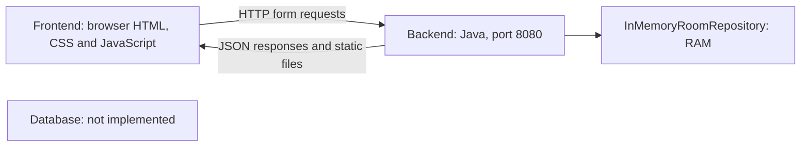

# Chess Software — Regalia

## Delivery objective

Build a chess application where two users connect through a shared room code, play alternating moves and consult their game history. The current delivery provides a browser interface, a Java backend, JSON communication and in-memory rooms. It is an incremental implementation, not a complete chess engine.

## Dependencies, build and execution

| Dependency | Version or use |
| --- | --- |
| JDK | 27 |
| Maven | Builds the three modules and resolves dependencies |
| Gson | 2.14.0, backend JSON serialization |
| JUnit Jupiter | 5.11.4, automated tests only |

From the repository root:

```bash
mvn compile
```

In IntelliJ, open the root `pom.xml`, select JDK 27, reload Maven and run `software.ulpgc.chess.backend.Main` using the `chess-backend` module. Open [Regalia](http://127.0.0.1:8080) in the browser.

The Java server listens on `127.0.0.1:8080` and serves the frontend and API. Keep it running while playing.

## Delivery structure and main classes

```text
./
├── pom.xml
├── README.md
├── chess-core/
│   ├── pom.xml
│   └── src/
│       ├── main/java/software/ulpgc/chess/
│       │   ├── application/domain/model/
│       │   ├── application/ports/
│       │   └── infrastructure/adapters/
│       └── test/java/software/ulpgc/chess/application/domain/model/
├── chess-backend/
│   ├── pom.xml
│   └── src/
│       ├── main/java/software/ulpgc/chess/backend/
│       │   ├── Main.java
│       │   ├── application/ports/
│       │   ├── application/usecases/
│       │   ├── infrastructure/adapters/
│       │   └── infrastructure/http/
│       └── test/java/software/ulpgc/chess/backend/
├── chess-frontend/
│   ├── pom.xml
│   └── src/main/resources/web/
│       ├── index.html
│       ├── style.css
│       ├── app.js
│       ├── room-api.js
│       └── assets/
└── docs/screenshots/
```

`chess-core` defines the chess rules and data model and supports loading board positions from FEN. `chess-backend` manages rooms and games and handles browser requests. `chess-frontend` displays the board, players and move history and lets users interact with the game.

## System architecture



The frontend and backend are separate source modules but use one server and origin at runtime. The backend depends on `chess-core`; the browser does not execute Java. Rooms and sessions are stored in memory, with no connection to a database.

### Backend hexagonal architecture

| Role | Concrete packages and classes |
| --- | --- |
| Domain | `chess-core`: `application/domain/model`, including `Room`, `Game`, `State`, `Board`, `User` and `Move` |
| Use cases | `chess-backend/application/usecases`: `CreateRoomUseCase`, `GetRoomUseCase`, `JoinRoomUseCase`, `EnterRoomUseCase`, `MoveUseCase` |
| Storage port | `chess-backend/application/ports/RoomRepository` |
| Storage adapter | `infrastructure/adapters/InMemoryRoomRepository` |
| Incoming HTTP adapter | `infrastructure/adapters/RoomApiHandler`, registered by `RoomHttpServer` |
| Transport support | `infrastructure/http`: `RoomActionRequest`, `RoomJsonCodec`, `ApiMessages`, `FormData`, `HttpResponses` |
| Session and asset adapters | `infrastructure/adapters/BrowserSessions`, `StaticAssetHandler` |

Package paths in the backend are relative to `software/ulpgc/chess/backend`. `Main` connects the collaborators through constructors. Storage-facing use cases depend on `RoomRepository`, while `EnterRoomUseCase` composes lookup and joining. Domain rules do not depend on HTTP, JSON or storage implementations.

### Lightweight frontend architecture

| Role | Current implementation |
| --- | --- |
| UI | `index.html` templates, `style.css`, SVG assets and rendering functions in `app.js` |
| Action coordination | `perform()` and event handlers in `app.js`: create, join, move, refresh and leave |
| Service boundary | The `state()` and `action()` operations used by `app.js` |
| Communication adapter | `RoomApi` in `room-api.js`, using `fetch` and `response.json()` |

The separation is currently lightweight: `app.js` constructs `RoomApi` directly. There is no independent use-case layer or injected service port in the frontend yet. Those remain architecture gaps relative to the full delivery requirements. The backend validates every submitted move.

## Communication contract

The frontend sends HTTP requests to the backend: `GET /api/state` retrieves the game state, and `POST /api/action` submits actions to create or join a room, move, refresh or leave. Requests use form fields; responses use JSON with the players, board, turn and history, or an error message.

## Data model and connecting users

| Model | Data and relationships |
| --- | --- |
| `User` | Identifier and name; no authenticated account |
| `Room` | Shared code, White user, optional Black user and one game |
| `Game` | Identifier, current `State` and immutable list of moves |
| `State` | Board and current turn |
| `Board` | Immutable mapping from `Square` to `Piece` |
| `Move` | Origin and destination squares |

The creator receives a six-character room code and plays White. The second user enters that code and plays Black. A third player is rejected. For local testing, use a normal and a private browser window; tabs in one profile share the same session. Click a piece and then a destination. Players, turns and moves update automatically by requesting the current state every two seconds while viewing a room. Refresh remains available for an immediate check. Drag-and-drop movement is not implemented.

## Incorporated idea

Players can reopen a room with its shared code during the same browser session and continue their game without losing its state or history.

## Required screenshots

User-provided captures from room `84A4FF`, with Ezequiel1 playing White and Ezequiel2 playing Black. The recorded history is held in memory, not persisted to a database.

Board with both players:


Room and shared code:


Game with recorded moves:


## Verification

Run all automated checks from the repository root:

```bash
mvn test
```

The latest run passed 39 tests: 5 domain invariants, 11 piece-movement tests, 13 room use-case tests, 3 request-validation tests and 7 HTTP integration tests. Coverage includes two independent cookie sessions, JSON responses, joining and reopening, token validation, piece-specific movement, blocked paths, pawn captures, turn enforcement and preservation of state after rejected operations.

The supplied captures show both users in room `84A4FF` and eight recorded moves, from `c2-c4` and `b8-c6` to `d1-a4` and `d7-d5`. They show the shared game state and in-memory history; persistent storage is still pending.

Automatic synchronization was also checked with two independent sessions: the creator detected the joining opponent, both clients received `e2-e4` and `e7-e5`, and neither needed manual refresh. A selected piece remained selected across unchanged state checks.
